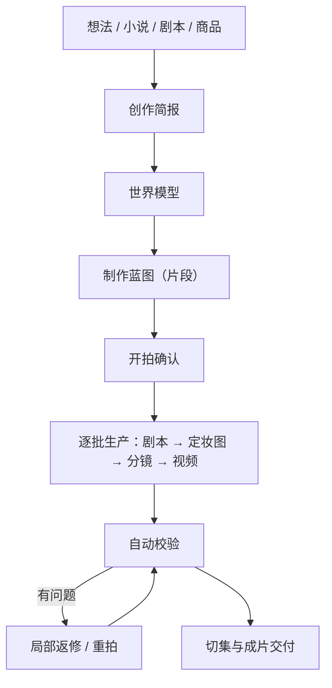

# 创作流程 {#workflows}

你以导演身份描述想要的结果，Zai 帮你整理制作方案，再按方案逐段生成、检查和返修，直到交付成片。本页说明制作流程、需要你确认的环节，以及提高作品一致性的方法。

## 1. 流程总览 {#overview}

- 一个项目只有一条 Zai 对话，从讨论方案一直延续到成片，不存在「创建阶段」和「生产阶段」两个助手。
- 平台只生成达成目标所必需的步骤；已经可用的产物不会重复生成。
- 全过程对你可见：每一步做了什么、花了多少、结果如何，都写在对话和工作台里。

## 2. 从对话到项目 {#conversation-to-project}

在首页发送第一句话（可附图片和小说 / 剧本文件）时，平台就建好项目并进入项目页。建项目、分析源文、讨论方案都不产生费用。

如果你提供了小说或剧本，Zai 会先做**剧本体检**：列出最多 5 条故事问题（缺集、逻辑漏洞、闲置角色、没有铺垫的转折等），每条附原文和改法，由你决定改不改。采纳的改动会写进改编要求，或补写成新的源文。

导入小说或剧本后，Zai 还会根据剧情从仿真人、3D 漫剧、2D 漫剧中推荐项目风格，默认使用仿真人；你可以在项目设置里修改。

## 3. 内容来源 {#content-sources}

### 3.1 小说原文 {#source-novel}

适合小说改编、网文推文和需要 AI 辅助分集的项目。Zai 会识别角色和别名、关键场景与道具、剧情阶段和可切分的集边界。

建议：

- 第一次不要上传整部长篇，先用一个剧情闭环的章节验证风格；
- 角色定妆图确认后再扩大制作范围。

### 3.2 成品剧本 {#source-screenplay}

适合已有对白、旁白和场景说明，希望尽量保留原稿的项目。原则是：

- 台词与画外音尽量逐字保留；
- 角色以作者提供的人物表和剧本为依据；
- 有台词的配角和群演（例如「宾客甲」）、跨段反复露面的无名人物会登记为角色；只露一面、没有台词的人群只写进画面描述，不膨胀成角色资产；
- 重点是规范化和镜头生产，而不是重新创作。

### 3.3 商品素材 {#source-product-material}

适合带货短片、产品演示和品牌短视频。请准备：

- 产品正面、侧面、细节和使用场景图片；
- 核心卖点、目标人群和禁止出现的表述；
- 品牌视觉要求、目标时长和发布平台。

商品会作为世界模型里的产品资产保存，项目里会出现「产品」页。先建立稳定的产品参考图，再生成场景化片段。

## 4. 三层方案 {#creative-plan}

Zai 把需求整理成三层方案，你可以随时要求修改：

| 层 | 内容 |
| --- | --- |
| 创作简报 | 意图、目标、受众、平台、时长、语气、来源素材、品牌要求、行动号召和硬约束。多个意图可以并存，例如「讲一个故事」同时「展示一款产品」 |
| 世界模型 | 角色、场景、道具、产品、视觉风格与连续性规则 |
| 制作蓝图 | 若干片段，每段声明类型、服务的意图、所需能力、时长、出场人物、视觉与声音方向 |

### 4.1 角色与造型 {#characters-and-looks}

一个角色是一个身份加一套或多套**造型**：脸和身材属于身份，所有造型共用；服装、发型、配饰属于造型。

- 主造型的定妆图是角色的身份锚点；变体造型以它为参考各出一张定妆图。
- 每一段穿哪一套，由剧本片段明确选择。角色有多套造型而片段没选时，这一段会停在剧本步骤，不会自动套用主造型。
- 重画主造型定妆图会让变体定妆图过期，影响范围会先列给你。

### 4.2 片段类型 {#segment-grammar}

每个片段声明自己是哪一类，同一部作品可以混用：

| 类型 | 适合 |
| --- | --- |
| 表演 | 角色对白与动作推动剧情 |
| 旁白 | 画外音讲述，画面服务叙事和氛围 |
| 展示 | 突出商品或物件的外观 |
| 演示 | 展示使用方法或过程 |
| 访谈 | 人物面对提问回答 |
| 口播 | 人物对镜头直接讲述 |
| 蒙太奇 | 多个画面快速组合表达一段时间或情绪 |
| 音乐视觉 | 画面随音乐节奏组织 |

项目没有「说书模式」「剧集模式」「广告模式」之分。一集里可以既有表演段，也有旁白段和展示段。

## 5. 片段的两种视频生成方式 {#video-production-routes}

每个片段恰好选择一种视频生成方式，由 Zai 在蓝图里逐段决定，不是项目级开关，也没有「创建后不可更改」的限制。

### 5.1 分镜引导 {#storyboard-image-route}

先为片段生成分镜图，再以分镜图作为首帧生成视频。

- 构图最可控，审核分镜就能提前发现问题；
- 相邻分镜会参考前一段的画面，便于衔接；
- 适合对白戏、需要精确站位和构图的片段。

同一段落的多个分镜也可以合成一张宫格一起出图，再切分成各段的分镜。宫格是分镜图的一种生成方式，由平台按需启用：按镜头数自动选用 2×2 或 3×3，单格比例与项目画面比例一致；更密的 4×4 / 5×5 只在图像分辨率为 4K 时使用，因为格数越多单格越小，会拖低视频画质。宫格只作用于分镜引导的片段。

### 5.2 参考引导 {#reference-video-route}

不生成分镜，直接把世界模型里的角色、场景、道具或产品参考图交给视频模型生成。

- 步骤更少，更直接地锚定角色或商品身份；
- 构图可控性低于分镜引导；
- 依赖模型的多参考图能力，参考图数量和类型因模型而异。

适合商品展示、身份一致性优先、构图要求不高的片段。

## 6. 声音 {#voice-and-audio}

- **对白**：由视频模型直接生成人声。
- **旁白**：项目有一个统一的旁白交付方式，可在「项目信息」的剧集参数中选择：
  - **后期配音**（默认）：成片不含旁白人声，你在导出后自行配音；
  - **TTS 配音**：平台为旁白片段合成配音，可在项目设置里选旁白配音模型、音色和语速。
- TTS 只作用于有旁白文本的片段；一批里全是对白时，不会出现 TTS 选项。
- 平台不生成背景音乐。

## 7. 开拍与生产 {#production-stages}

### 7.1 开拍确认 {#production-start}

方案就绪后，Zai 会给出开拍报价：片段数、视频秒数、分镜数、设定图数、当前余额和未包含的项目。你批准后，这笔额度记在项目对话上，额度内的步骤自动执行。

开拍可以只拍一部分，例如「先拍第一集」「只拍前两段」；报价只算这些片段，之后每一步都守这个范围。拍完这部分后，再告诉 Zai 接着拍剩下的。

### 7.2 批次与集 {#batches-and-episodes}

- **批次**是生产单位：平台把片段分成若干批，一批的剧本、分镜和视频都做完，就进入下一批。
- **片段**是批次里最小的生产单元。
- **集**是交付单位：平台从片段序列中切出每一集，按目标时长并尽量落在集尾钩子上；一集的片段都齐了才合成这一集，已放行的集边界会冻结。

工作台的「看板」按「方案与剧本 / 设定图 / 分镜 / 视频 / 成片」五站显示进度，「批次」页可以逐批预览和审改。

## 8. 产物状态 {#artifact-currency}

平台按产物生成时的输入判断它的状态：

- **当前**：与当前方案、剧本和所选版本一致；
- **过期**：产物仍可预览和导出，但生成后相关输入已经改变；
- **缺失**：还没有可用产物，需要生成；
- **阻塞**：引用或记录有问题，需要先修复，平台不会把它当作缺失项自动付费重做。

批量生成默认只补齐缺失项，当前和过期产物都会保留。修改提示词、角色或剧本后，界面会提示有多少产物「比当前内容旧」；想刷新哪一段，在对话里让 Zai 重拍即可。自动校验判定有严重问题的产物，即使状态是当前或过期，也不会被当作可用结果。

## 9. 自动校验与返修 {#checks-and-repair}

每件媒体产物生成后，平台会自动检查，结论分为通过、未通过和跳过（例如缺少比对依据时），不会把跳过冒充通过。

| 检查 | 级别 | 说明 |
| --- | --- | --- |
| 媒体完整性 | 严重 | 文件轨道或时长与请求不一致 |
| 黑帧 | 严重 | 全黑画面占比过高 |
| 分镜锚点 | 严重 | 视频首帧与分镜图基本无关 |
| 静音 | 提醒 | 音频大部分是静音 |
| 角色在场 | 提醒 | 该出场的角色没有出现在画面里 |
| 定妆图版式 | 提醒 | 定妆图不符合规定版式 |
| 改编机械 | 提醒 | 剧本改编过于机械地照搬原文 |

只有「严重」级别的确定失败会让产物不可用。视频和音频类的未通过项会被自动返修：每次返修都会改变输入（例如换随机种子、加强参考、缩短时长），同一个问题返修到上限后停止，交回你决定。定妆图版式和改编机械这两项换个种子未必能纠正，会直接交给你决定重生成还是修改。

你也可以主动重拍某一段：在对话里说清哪段、怎么改，Zai 会给出旧 → 新的改法对照，确认后只重做这一段。重拍和返修使用开拍额度之外的返工额度。「候选审片」会按评分列出同一段的候选版本，你可以选定并锁定、退回或再出一条。

## 10. 确认点 {#review-gates}

Zai 默认自动推进，只在两类情况下停下来请你确认：

| 情况 | 例子 |
| --- | --- |
| 要花钱或不可逆地消耗资源 | 开拍报价、超出开拍额度的步骤、返工额度不足、取消或回退生产 |
| 要覆盖你已经做过的工作 | 改写你手工编辑过的剧本、覆盖已有的视觉风格或资产定义、删除已出过定妆图的造型 |

分析源文、整理资产、规划批次、首次写剧本、修改标题和简介等动作直接执行，做完告诉你。确认在对话框上方就地进行，花钱的确认一定同时给出美元金额；确认卡摆着时插一句新的话，卡就作废，Zai 按新要求重来。

## 11. 一致性实践 {#consistency-practices}

### 角色 {#consistency-characters}

- 保持固定的年龄、发型、体型和核心服装描述；
- 不同主要角色要有明显区分的特征；
- 剧情需要换装时新增造型，并在剧本里逐段选择，而不是靠提示词临时描述。

### 场景 {#consistency-scenes}

- 重要场景建立参考资产，固定空间方位和主要陈设；
- 同一段剧情不要频繁切换不必要的光线和时间。

### 道具和产品 {#consistency-props}

- 对剧情关键物品建立道具资产；
- 商品优先使用多角度真实照片；
- 不让模型自行补全重要文字、Logo 和结构；
- 发现细节漂移时重拍对应片段，不要靠后续片段掩盖。

## 12. 控制返工 {#cost-control-practices}

- 先拍少量片段验证风格，再扩大范围；
- 先确认角色定妆图和造型，再批量出分镜和视频；
- 单个片段有问题只重拍这一段，不要重开整集；
- 需要保留的版本及时「锁定当前版本」，避免被重新生成替换。

## 13. 完成定义 {#definition-of-done}

一集或一条短片至少满足以下条件才算完成：

- 方案和剧本已确认；
- 主要角色的定妆图和造型已确认；
- 片段没有「严重」级别的校验失败；
- 角色和产品没有明显的身份漂移，片段之间衔接自然；
- 旁白和字幕已校对；
- 成片可以正常播放和下载。
