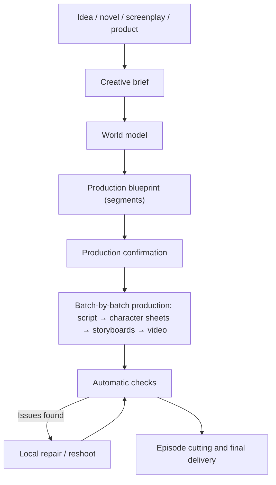

# Creative Workflow {#workflows}

Describe the result you want as the director. Zai helps turn it into a production plan, then generates, checks, and revises the segments to deliver the finished video. This page explains the process, the decisions that need your approval, and ways to keep the result consistent.

## 1. Overview {#overview}

- A project has a single Zai conversation that runs from discussing the plan all the way to the final cut. There are no separate "creation stage" and "production stage" assistants.
- The platform generates only the steps needed to reach the goal; artifacts that are already usable are not generated again.
- The whole process is visible to you: what each step did, what it cost, and what it produced are all recorded in the conversation and the workspace.

## 2. From conversation to project {#conversation-to-project}

When you send your first message on the home page (optionally with images and novel / screenplay files), the platform creates the project and opens the project page. Creating the project, analyzing the source text, and discussing the plan are free of charge.

If you provide a novel or screenplay, Zai first runs a **script review**: it lists up to 5 story issues (missing episodes, plot holes, characters with no clear role, twists without setup, and so on), each with the original passage and a suggested fix, and you decide whether to apply them. Accepted changes are written into the adaptation requirements, or written up as new source text.

After a novel or screenplay is imported, Zai also recommends a project style based on the story — Photorealistic, 3D drama, or 2D drama. Photorealistic is the default; you can change it in project settings.

## 3. Content sources {#content-sources}

### 3.1 Novel {#source-novel}

Suited to novel adaptations, web-novel recap videos, and projects that need AI-assisted episode splitting. Zai identifies characters and their aliases, key scenes and props, story phases, and episode boundaries where the text can be split.

Recommendations:

- Do not upload an entire long novel the first time; validate the style with a chapter that forms a closed story arc first;
- Expand the production scope only after the character sheets are confirmed.

### 3.2 Finished screenplay {#source-screenplay}

Suited to projects that already have dialogue, narration, and scene descriptions and want to keep the original manuscript as intact as possible. The principles are:

- Keep dialogue and voiceover as close to verbatim as possible;
- Base the characters on the author's cast list and screenplay;
- Supporting characters and extras with lines (for example "Guest A"), as well as unnamed people who appear repeatedly across segments, are registered as characters; crowds that appear only once without lines are written only into the shot descriptions and are not inflated into character assets;
- The focus is normalization and shot production, not rewriting.

### 3.3 Product material {#source-product-material}

Suited to product-promotion shorts, product demos, and short brand videos. Prepare:

- Front, side, detail, and in-use images of the product;
- Core selling points, target audience, and claims that must not appear;
- Brand visual requirements, target duration, and publishing platform.

The product is saved as a product asset in the world model, and a "Products" page appears in the project. Establish stable product reference images first, then generate scenario-based segments.

## 4. The three-layer plan {#creative-plan}

Zai organizes your request into a three-layer plan, and you can ask for changes at any time:

| Layer | Contents |
| --- | --- |
| Creative brief | Intent, goals, audience, platform, duration, tone, source material, brand requirements, call to action, and hard constraints. Multiple intents can coexist, for example "tell a story" while also "showcasing a product" |
| World model | Characters, scenes, props, products, visual style, and continuity rules |
| Production blueprint | A set of segments; each declares its type, the intent it serves, the capabilities it needs, duration, characters on screen, and visual and audio direction |

### 4.1 Characters and looks {#characters-and-looks}

A character is one identity plus one or more **looks**: face and body belong to the identity and are shared by all looks; clothing, hairstyle, and accessories belong to a look.

- The character sheet of the primary look is the character's identity anchor; each variant look gets its own character sheet using it as the reference.
- Which look is worn in each segment is chosen explicitly by the script segment. If a character has multiple looks and a segment has not chosen one, that segment stops at the script step instead of automatically falling back to the primary look.
- Redrawing the primary look's character sheet makes the variant character sheets stale; the affected scope is listed for you first.

### 4.2 Segment types {#segment-grammar}

Each segment has a type, and a single project can combine several types:

| Type | Suited to |
| --- | --- |
| Performance | Characters' dialogue and actions drive the story |
| Voiceover | An off-screen voice narrates; the visuals serve the narrative and atmosphere |
| Showcase | Highlighting the appearance of a product or object |
| Demo | Showing how something is used or a process |
| Interview | A person answers questions |
| Talking head | A person speaks directly to the camera |
| Montage | Many shots combined quickly to convey a span of time or an emotion |
| Music visual | Visuals organized around the rhythm of music |

Projects have no separate "storytelling mode", "drama mode", or "ad mode". A single episode can contain performance segments alongside voiceover and showcase segments.

## 5. Two video generation methods for segments {#video-production-routes}

Each segment chooses exactly one video generation method. Zai decides it per segment in the blueprint; it is not a project-level switch, and there is no "cannot be changed after creation" restriction.

### 5.1 Storyboard-guided {#storyboard-image-route}

Storyboard images are generated for the segment first, and the video is then generated using the storyboard image as the first frame.

- Composition is the most controllable, and reviewing the storyboards surfaces problems early;
- Adjacent storyboards reference the previous segment's frame, which helps continuity;
- Suited to dialogue scenes and segments that need precise blocking and composition.

Multiple storyboards in the same sequence can also be combined into one grid storyboard, generated together, and then cut into each segment's storyboard. The grid storyboard is one way of generating storyboard images, and the platform enables it as needed: it automatically uses 2×2 or 3×3 based on the number of shots, with each cell matching the project's aspect ratio; the denser 4×4 / 5×5 grids are used only when the image resolution is 4K, because more cells mean smaller cells, which lowers video quality. Grid storyboards apply only to storyboard-guided segments.

### 5.2 Reference-guided {#reference-video-route}

No storyboards are generated; the reference images of characters, scenes, props, or products from the world model are passed directly to the video model.

- Fewer steps, and a more direct anchor on character or product identity;
- Composition is less controllable than with storyboard-guided generation;
- It relies on the model's multi-reference capability; the number and types of reference images vary by model.

Suited to product showcases and segments where identity consistency comes first and composition requirements are modest.

## 6. Audio {#voice-and-audio}

- **Dialogue**: voices are generated directly by the video model.
- **Narration**: a project has one unified narration delivery method, which you choose in the Episode Parameters under "Project info":
  - **Dub in post** (default): the final cut contains no narration voice, and you record the voiceover yourself after exporting;
  - **TTS voice**: the platform synthesizes voiceover for narration segments; you can choose the narration voice model, voice, and speed in project settings.
- TTS applies only to segments with narration text; when a batch is all dialogue, the TTS option does not appear.
- The platform does not generate background music.

## 7. Starting and running production {#production-stages}

### 7.1 Production confirmation {#production-start}

Once the plan is ready, Zai gives a production quote: number of segments, seconds of video, number of storyboards, number of reference sheets, current balance, and anything not included. After you approve it, the budget is recorded on the project conversation, and steps within that budget run automatically.

You can start with only part of the work, for example "shoot episode 1 first" or "only shoot the first two segments"; the quote covers only those segments, and every subsequent step stays within that scope. When that part is done, tell Zai to continue with the rest.

### 7.2 Batches and episodes {#batches-and-episodes}

- A **batch** is the unit of production: the platform divides the segments into several batches, and once a batch's script, storyboards, and videos are all done, it moves on to the next batch.
- A **segment** is the smallest production unit within a batch.
- An **episode** is the unit of delivery: the platform cuts each episode from the segment sequence according to the target duration, landing on an end-of-episode hook where possible; an episode is assembled only once all of its segments are ready, and episode boundaries that have been released are frozen.

The workspace's "Dashboard" shows progress across five stations — "Plan and script / Reference sheets / Storyboards / Videos / Final cut" — and the "Batches" page lets you preview, review, and revise batch by batch.

## 8. Artifact status {#artifact-currency}

The platform determines an artifact's status from the inputs it was generated with:

- **current**: consistent with the current plan, script, and selected versions;
- **stale**: the artifact can still be previewed and exported, but related inputs have changed since it was generated;
- **missing**: there is no usable artifact yet, and it needs to be generated;
- **blocked**: a reference or record has a problem that must be fixed first; the platform will not treat it as missing and automatically pay to regenerate it.

Batch generation fills in only missing items by default; current and stale artifacts are both kept. After you change prompts, characters, or the script, the interface shows how many artifacts "are older than the current content"; to refresh a particular segment, ask Zai to reshoot it in the conversation. An artifact that automatic checks judge to have a Blocker issue is not treated as a usable result, even if its status is current or stale.

## 9. Automatic checks and repair {#checks-and-repair}

After each media artifact is generated, the platform checks it automatically. The verdict is passed, failed, or skipped (for example, when there is nothing to compare against); a skip is never passed off as a pass.

| Check | Level | Description |
| --- | --- | --- |
| Media integrity | Blocker | The file's tracks or duration do not match the request |
| Black frames | Blocker | Fully black frames make up too large a share |
| Storyboard anchor | Blocker | The video's first frame is essentially unrelated to the storyboard image |
| Silence | Warning | Most of the audio is silent |
| Character presence | Warning | A character who should appear is not in the frame |
| Character sheet layout | Warning | The character sheet does not follow the required layout |
| Mechanical adaptation | Warning | The script adaptation copies the source text too mechanically |

Only a definite failure at the Blocker level makes an artifact unusable. Failed video and audio checks are repaired automatically: each repair changes the inputs (for example, a new random seed, stronger references, or a shorter duration), and once the same issue reaches the repair limit, repair stops and the decision is handed back to you. Character sheet layout and mechanical adaptation are not necessarily fixed by changing the seed, so they go straight to you to decide whether to regenerate or revise.

You can also proactively reshoot a segment: say in the conversation which segment and how to change it, and Zai shows an old → new comparison of the change; after you confirm, only that segment is redone. Reshoots and repairs use a rework budget separate from the production budget. "Candidate review" lists the candidate versions of the same segment by score, and you can select and pin one, send it back, or generate another.

## 10. Confirmation points {#review-gates}

Zai moves forward automatically by default and stops to ask for your confirmation in only two kinds of situations:

| Situation | Examples |
| --- | --- |
| Spending money or irreversibly consuming resources | The production quote, steps beyond the production budget, insufficient rework budget, cancelling or rolling back production |
| Overwriting work you have already done | Rewriting a script you edited by hand, overwriting an existing visual style or asset definition, deleting a look that already has a character sheet |

Actions such as analyzing source text, organizing assets, planning batches, writing the script for the first time, and changing the title and synopsis run directly, and Zai tells you when they are done. Confirmation happens in place above the chat input, and any confirmation that spends money always shows the amount in USD; if you send a new message while a confirmation card is showing, the card is voided and Zai starts over with the new request.

## 11. Consistency practices {#consistency-practices}

### Characters {#consistency-characters}

- Keep age, hairstyle, build, and core clothing descriptions fixed;
- Give different main characters clearly distinguishable features;
- When the story needs a costume change, add a look and choose it segment by segment in the script, rather than describing it ad hoc in prompts.

### Scenes {#consistency-scenes}

- Create reference assets for important scenes, fixing the spatial layout and main furnishings;
- Within the same stretch of story, avoid frequent, unnecessary changes of lighting and time of day.

### Props and products {#consistency-props}

- Create prop assets for items that are key to the story;
- For products, prefer real photos from multiple angles;
- Do not let the model fill in important text, logos, or structure on its own;
- When you notice details drifting, reshoot the corresponding segment instead of covering it up with later segments.

## 12. Keeping rework under control {#cost-control-practices}

- Shoot a few segments first to validate the style, then expand the scope;
- Confirm character sheets and looks before generating storyboards and videos in bulk;
- If a single segment has a problem, reshoot only that segment instead of restarting the whole episode;
- Use "Pin current version" promptly on versions you want to keep, so they are not replaced by regeneration.

## 13. Definition of done {#definition-of-done}

An episode or short video counts as done only when it meets at least the following conditions:

- The plan and script are confirmed;
- The main characters' character sheets and looks are confirmed;
- No segment has a check failure at the Blocker level;
- Characters and products show no obvious identity drift, and segments flow naturally into one another;
- Narration and subtitles have been proofread;
- The final video plays and downloads normally.
