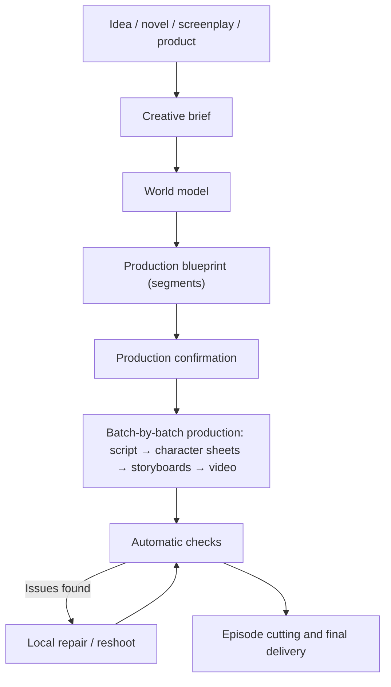

# Flujo de trabajo creativo {#workflows}

Como director, describe el resultado que buscas. Zai te ayuda a preparar un plan de producción y después genera, comprueba y revisa los segmentos hasta entregar el vídeo final. Esta página explica el proceso, las decisiones que requieren tu aprobación y cómo mantener la coherencia de la obra.

## 1. Visión general {#overview}

- Un proyecto tiene una única conversación con Zai que va desde la discusión del plan hasta el corte final. No hay asistentes separados de «fase de creación» y «fase de producción».
- La plataforma genera solo los pasos necesarios para alcanzar el objetivo; los elementos que ya se pueden usar no se generan de nuevo.
- Todo el proceso es visible para ti: lo que hizo cada paso, cuánto costó y qué produjo queda registrado en la conversación y en el espacio de trabajo.

## 2. De la conversación al proyecto {#conversation-to-project}

Cuando envías tu primer mensaje en la página de inicio (opcionalmente con imágenes y archivos de novela o guion), la plataforma crea el proyecto y abre la página del proyecto. Crear el proyecto, analizar el texto original y discutir el plan son gratuitos.

Si aportas una novela o un guion, Zai realiza primero una **revisión del guion**: enumera hasta 5 problemas narrativos (episodios que faltan, agujeros de trama, personajes sin un papel claro, giros sin preparación, etc.), cada uno con el pasaje original y una solución sugerida, y tú decides si aplicarlos. Los cambios aceptados se incorporan a los requisitos de adaptación o se redactan como nuevo texto original.

Después de importar una novela o un guion, Zai también recomienda un estilo de proyecto basado en la historia: fotorrealista, drama 3D o drama 2D. El fotorrealista es el predeterminado; puedes cambiarlo en los ajustes del proyecto.

## 3. Fuentes de contenido {#content-sources}

### 3.1 Novela {#source-novel}

Adecuada para adaptaciones de novelas, vídeos de recapitulación de novelas web y proyectos que necesitan división de episodios asistida por IA. Zai identifica personajes y sus alias, escenas y objetos clave, fases de la historia y límites de episodio donde se puede dividir el texto.

Recomendaciones:

- No subas una novela larga entera la primera vez; valida primero el estilo con un capítulo que forme un arco narrativo cerrado;
- Amplía el alcance de producción solo después de confirmar las fichas de personaje.

### 3.2 Guion terminado {#source-screenplay}

Adecuada para proyectos que ya tienen diálogos, narración y descripciones de escena y quieren conservar el manuscrito original lo más intacto posible. Los principios son:

- Mantener los diálogos y la voz en off lo más cerca posible del texto literal;
- Basar los personajes en el reparto y el guion del autor;
- Los personajes secundarios y figurantes con frases (por ejemplo, «Invitado A»), así como personas sin nombre que aparecen repetidamente en varios segmentos, se registran como personajes; las multitudes que aparecen una sola vez sin frases se escriben solo en las descripciones de plano y no se inflan como recursos de personaje;
- El objetivo es la normalización y la producción de planos, no la reescritura.

### 3.3 Material de producto {#source-product-material}

Adecuada para piezas cortas de promoción de producto, demostraciones de producto y vídeos breves de marca. Prepara:

- Imágenes frontales, laterales, de detalle y en uso del producto;
- Puntos de venta principales, público objetivo y afirmaciones que no deben aparecer;
- Requisitos visuales de marca, duración objetivo y plataforma de publicación.

El producto se guarda como recurso de producto en el modelo de mundo, y aparece una página «Productos» en el proyecto. Establece primero imágenes de referencia estables del producto y después genera segmentos basados en escenarios.

## 4. El plan de tres capas {#creative-plan}

Zai organiza tu petición en un plan de tres capas, y puedes pedir cambios en cualquier momento:

| Capa | Contenido |
| --- | --- |
| Brief creativo | Intención, objetivos, audiencia, plataforma, duración, tono, material original, requisitos de marca, llamada a la acción y restricciones estrictas. Pueden coexistir varias intenciones, por ejemplo «contar una historia» y a la vez «mostrar un producto» |
| Modelo de mundo | Personajes, escenas, objetos, productos, estilo visual y reglas de continuidad |
| Plano de producción | Un conjunto de segmentos; cada uno declara su tipo, la intención a la que sirve, las capacidades que necesita, la duración, los personajes en pantalla y la dirección visual y de audio |

### 4.1 Personajes y apariencias {#characters-and-looks}

Un personaje es una identidad más una o varias **apariencias**: la cara y el cuerpo pertenecen a la identidad y los comparten todas las apariencias; la ropa, el peinado y los accesorios pertenecen a una apariencia.

- La ficha de personaje de la apariencia principal es el ancla de identidad del personaje; cada apariencia variante recibe su propia ficha de personaje usándola como referencia.
- La apariencia que se lleva en cada segmento la elige explícitamente el guion del segmento. Si un personaje tiene varias apariencias y un segmento no ha elegido una, ese segmento se detiene en el paso de guion en lugar de recurrir automáticamente a la apariencia principal.
- Redibujar la ficha de personaje de la apariencia principal deja obsoletas las fichas de las apariencias variantes; primero se te muestra el alcance afectado.

### 4.2 Tipos de segmento {#segment-grammar}

Cada segmento tiene un tipo, y un mismo proyecto puede combinar varios tipos:

| Tipo | Adecuado para |
| --- | --- |
| Interpretación | Los diálogos y acciones de los personajes impulsan la historia |
| Voz en off | Una voz fuera de pantalla narra; las imágenes sirven a la narración y la atmósfera |
| Escaparate | Destacar la apariencia de un producto u objeto |
| Demostración | Mostrar cómo se usa algo o un proceso |
| Entrevista | Una persona responde a preguntas |
| Busto parlante | Una persona habla directamente a cámara |
| Montaje | Muchos planos combinados rápidamente para transmitir un lapso de tiempo o una emoción |
| Visual musical | Imágenes organizadas en torno al ritmo de la música |

Los proyectos no tienen un «modo narración», «modo drama» o «modo anuncio» separado. Un mismo episodio puede contener segmentos de interpretación junto a segmentos de voz en off y de escaparate.

## 5. Dos métodos de generación de vídeo para segmentos {#video-production-routes}

Cada segmento elige exactamente un método de generación de vídeo. Zai lo decide por segmento en el plano de producción; no es un interruptor a nivel de proyecto y no existe la restricción de «no se puede cambiar después de crearlo».

### 5.1 Guiado por guion gráfico {#storyboard-image-route}

Primero se generan las imágenes del guion gráfico del segmento y después se genera el vídeo usando la imagen del guion gráfico como primer fotograma.

- La composición es la más controlable, y revisar los guiones gráficos hace aflorar los problemas pronto;
- Los guiones gráficos adyacentes referencian el fotograma del segmento anterior, lo que ayuda a la continuidad;
- Adecuado para escenas de diálogo y segmentos que necesitan bloqueo y composición precisos.

Varios guiones gráficos de la misma secuencia también pueden combinarse en un guion gráfico en cuadrícula, generarse juntos y después cortarse en el guion gráfico de cada segmento. El guion gráfico en cuadrícula es una forma de generar imágenes de guion gráfico, y la plataforma lo habilita según sea necesario: usa automáticamente cuadrículas de 2×2 o 3×3 según el número de planos, con cada celda ajustada a la relación de aspecto del proyecto; las cuadrículas más densas de 4×4 / 5×5 se usan solo cuando la resolución de imagen es 4K, porque más celdas implican celdas más pequeñas, lo que reduce la calidad del vídeo. Los guiones gráficos en cuadrícula se aplican solo a los segmentos guiados por guion gráfico.

### 5.2 Guiado por referencia {#reference-video-route}

No se generan guiones gráficos; las imágenes de referencia de personajes, escenas, objetos o productos del modelo de mundo se pasan directamente al modelo de vídeo.

- Menos pasos y un anclaje más directo a la identidad del personaje o del producto;
- La composición es menos controlable que con la generación guiada por guion gráfico;
- Depende de la capacidad multirreferencia del modelo; el número y los tipos de imágenes de referencia varían según el modelo.

Adecuado para escaparates de producto y segmentos donde la coherencia de identidad es lo primero y los requisitos de composición son modestos.

## 6. Audio {#voice-and-audio}

- **Diálogo**: las voces las genera directamente el modelo de vídeo.
- **Narración**: un proyecto tiene un único método de entrega de narración, que eliges en los Parámetros del episodio, bajo «Información del proyecto»:
  - **Doblar en posproducción** (predeterminado): el corte final no contiene voz de narración, y grabas tú mismo la voz en off después de exportar;
  - **Voz TTS**: la plataforma sintetiza la voz en off para los segmentos de narración; puedes elegir el modelo de voz de narración, la voz y la velocidad en los ajustes del proyecto.
- El TTS se aplica solo a los segmentos con texto de narración; cuando un lote es todo diálogo, la opción TTS no aparece.
- La plataforma no genera música de fondo.

## 7. Iniciar y ejecutar la producción {#production-stages}

### 7.1 Confirmación de producción {#production-start}

Cuando el plan está listo, Zai entrega un presupuesto de producción: número de segmentos, segundos de vídeo, número de guiones gráficos, número de fichas de referencia, saldo actual y cualquier cosa no incluida. Después de que lo apruebes, el presupuesto se registra en la conversación del proyecto y los pasos dentro de ese presupuesto se ejecutan automáticamente.

Puedes empezar solo con una parte del trabajo, por ejemplo «rueda primero el episodio 1» o «rueda solo los dos primeros segmentos»; el presupuesto cubre únicamente esos segmentos, y cada paso posterior se mantiene dentro de ese alcance. Cuando esa parte termine, pide a Zai que continúe con el resto.

### 7.2 Lotes y episodios {#batches-and-episodes}

- Un **lote** es la unidad de producción: la plataforma divide los segmentos en varios lotes y, una vez que el guion, los guiones gráficos y los vídeos de un lote están terminados, pasa al siguiente lote.
- Un **segmento** es la unidad de producción más pequeña dentro de un lote.
- Un **episodio** es la unidad de entrega: la plataforma corta cada episodio a partir de la secuencia de segmentos según la duración objetivo, aterrizando en un gancho de final de episodio cuando es posible; un episodio se monta solo cuando todos sus segmentos están listos, y los límites de episodio ya publicados se congelan.

El «Panel» del espacio de trabajo muestra el progreso en cinco estaciones —«Plan y guion / Fichas de referencia / Guiones gráficos / Vídeos / Corte final»— y la página «Lotes» te permite previsualizar, revisar y revisar lote a lote.

## 8. Estado de los recursos {#artifact-currency}

La plataforma determina el estado de un recurso a partir de las entradas con las que se generó:

- **actual**: coherente con el plan, el guion y las versiones seleccionadas actuales;
- **obsoleto**: el recurso aún se puede previsualizar y exportar, pero las entradas relacionadas han cambiado desde que se generó;
- **faltante**: todavía no hay un recurso utilizable y es necesario generarlo;
- **bloqueado**: una referencia o registro tiene un problema que debe corregirse primero; la plataforma no lo tratará como faltante ni pagará automáticamente para regenerarlo.

La generación por lotes rellena solo los elementos faltantes por defecto; los recursos actuales y obsoletos se conservan. Después de que cambies las instrucciones, los personajes o el guion, la interfaz muestra cuántos recursos «son anteriores al contenido actual»; para actualizar un segmento concreto, pide a Zai que lo ruede de nuevo en la conversación. Un recurso que las comprobaciones automáticas consideren con un problema de nivel Bloqueante no se trata como resultado utilizable, aunque su estado sea actual u obsoleto.

## 9. Comprobaciones y reparación automáticas {#checks-and-repair}

Después de generar cada recurso multimedia, la plataforma lo comprueba automáticamente. El veredicto es aprobado, suspendido u omitido (por ejemplo, cuando no hay nada con qué comparar); una omisión nunca se hace pasar por una aprobación.

| Comprobación | Nivel | Descripción |
| --- | --- | --- |
| Integridad del medio | Bloqueante | Las pistas o la duración del archivo no coinciden con la solicitud |
| Fotogramas negros | Bloqueante | Los fotogramas totalmente negros ocupan una proporción demasiado grande |
| Anclaje al guion gráfico | Bloqueante | El primer fotograma del vídeo no guarda relación esencial con la imagen del guion gráfico |
| Silencio | Advertencia | La mayor parte del audio está en silencio |
| Presencia de personaje | Advertencia | Un personaje que debería aparecer no está en el encuadre |
| Maquetación de la ficha de personaje | Advertencia | La ficha de personaje no sigue la maquetación requerida |
| Adaptación mecánica | Advertencia | La adaptación del guion copia el texto original de forma demasiado mecánica |

Solo un fallo definitivo de nivel Bloqueante hace que un recurso sea inutilizable. Los fallos de comprobación de vídeo y audio se reparan automáticamente: cada reparación cambia las entradas (por ejemplo, una nueva semilla aleatoria, referencias más firmes o una duración más corta) y, cuando el mismo problema alcanza el límite de reparaciones, la reparación se detiene y la decisión vuelve a ti. La maquetación de la ficha de personaje y la adaptación mecánica no se corrigen necesariamente cambiando la semilla, así que pasan directamente a ti para decidir si regenerar o revisar.

También puedes volver a rodar un segmento de forma proactiva: di en la conversación qué segmento y cómo cambiarlo, y Zai muestra una comparación antes → después del cambio; tras tu confirmación, solo se rehace ese segmento. Los nuevos rodajes y las reparaciones usan un presupuesto de retrabajo separado del presupuesto de producción. La «Revisión de candidatos» lista las versiones candidatas del mismo segmento por puntuación, y puedes seleccionar y fijar una, devolverla o generar otra.

## 10. Puntos de confirmación {#review-gates}

Zai avanza automáticamente por defecto y se detiene a pedir tu confirmación solo en dos tipos de situaciones:

| Situación | Ejemplos |
| --- | --- |
| Gastar dinero o consumir recursos de forma irreversible | El presupuesto de producción, pasos que superan el presupuesto de producción, presupuesto de retrabajo insuficiente, cancelar o revertir la producción |
| Sobrescribir trabajo que ya has hecho | Reescribir un guion que editaste a mano, sobrescribir un estilo visual o una definición de recurso existente, eliminar una apariencia que ya tiene ficha de personaje |

Acciones como analizar el texto original, organizar recursos, planificar lotes, escribir el guion por primera vez y cambiar el título y la sinopsis se ejecutan directamente, y Zai te avisa cuando terminan. La confirmación aparece in situ, encima del campo de chat, y cualquier confirmación que gaste dinero muestra siempre el importe en USD; si envías un mensaje nuevo mientras se muestra una tarjeta de confirmación, la tarjeta se anula y Zai empieza de nuevo con la nueva petición.

## 11. Prácticas de coherencia {#consistency-practices}

### Personajes {#consistency-characters}

- Mantén fijas la edad, el peinado, la complexión y las descripciones básicas de la ropa;
- Da a los personajes principales rasgos claramente distinguibles entre sí;
- Cuando la historia necesite un cambio de vestuario, añade una apariencia y elígela segmento a segmento en el guion, en lugar de describirla de forma improvisada en las instrucciones.

### Escenas {#consistency-scenes}

- Crea recursos de referencia para las escenas importantes, fijando la disposición espacial y el mobiliario principal;
- Dentro del mismo tramo de historia, evita cambios de iluminación y de hora del día frecuentes e innecesarios.

### Objetos y productos {#consistency-props}

- Crea recursos de objeto para los elementos clave de la historia;
- Para productos, prefiere fotos reales desde varios ángulos;
- No dejes que el modelo rellene por su cuenta textos, logotipos o estructuras importantes;
- Cuando notes que los detalles se desvían, vuelve a rodar el segmento correspondiente en lugar de taparlo con segmentos posteriores.

## 12. Mantener el retrabajo bajo control {#cost-control-practices}

- Rueda primero unos pocos segmentos para validar el estilo y después amplía el alcance;
- Confirma las fichas de personaje y las apariencias antes de generar guiones gráficos y vídeos en bloque;
- Si un único segmento tiene un problema, vuelve a rodar solo ese segmento en lugar de reiniciar todo el episodio;
- Usa «Fijar versión actual» cuanto antes en las versiones que quieras conservar, para que no se sustituyan al regenerar.

## 13. Definición de terminado {#definition-of-done}

Un episodio o vídeo corto se considera terminado solo cuando cumple al menos las siguientes condiciones:

- El plan y el guion están confirmados;
- Las fichas de personaje y las apariencias de los personajes principales están confirmadas;
- Ningún segmento tiene un fallo de comprobación de nivel Bloqueante;
- Los personajes y los productos no muestran una desviación de identidad evidente, y los segmentos fluyen con naturalidad entre sí;
- La narración y los subtítulos se han revisado;
- El vídeo final se reproduce y se descarga con normalidad.
