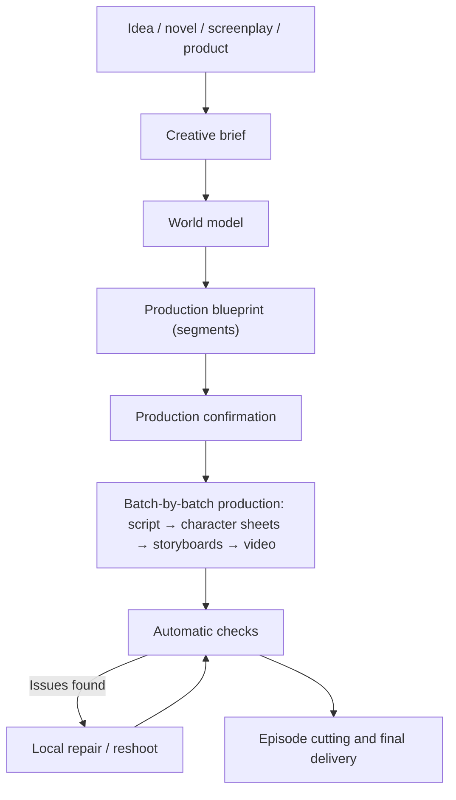

# Flux de travail créatif {#workflows}

En tant que réalisateur, décrivez le résultat souhaité. Zai vous aide à établir un plan de production, puis génère, vérifie et révise les séquences jusqu’à la livraison de la vidéo finale. Cette page présente les étapes, les décisions qui nécessitent votre accord et les moyens de préserver la cohérence du résultat.

## 1. Aperçu {#overview}

- Un projet possède une seule conversation Zai qui va de la discussion du plan jusqu'à la version finale. Il n'y a pas d'assistants séparés pour l'« étape de création » et l'« étape de production ».
- La plateforme ne génère que les étapes nécessaires pour atteindre l'objectif ; les artefacts déjà utilisables ne sont pas générés à nouveau.
- L'ensemble du processus vous est visible : ce que chaque étape a fait, ce qu'elle a coûté et ce qu'elle a produit sont enregistrés dans la conversation et dans l'espace de travail.

## 2. De la conversation au projet {#conversation-to-project}

Lorsque vous envoyez votre premier message sur la page d'accueil (éventuellement avec des images et des fichiers de roman ou de scénario), la plateforme crée le projet et ouvre la page du projet. La création du projet, l'analyse du texte source et la discussion du plan sont gratuites.

Si vous fournissez un roman ou un scénario, Zai effectue d'abord une **révision du script** : il liste jusqu'à 5 problèmes narratifs (épisodes manquants, incohérences de l'intrigue, personnages sans rôle clair, retournements sans préparation, etc.), chacun accompagné du passage original et d'une correction suggérée, et vous décidez de les appliquer ou non. Les modifications acceptées sont intégrées aux exigences d'adaptation, ou consignées comme nouveau texte source.

Après l'importation d'un roman ou d'un scénario, Zai recommande également un style de projet basé sur l'histoire — Photoréaliste, Drame 3D ou Drame 2D. Le style photoréaliste est le style par défaut ; vous pouvez le modifier dans les paramètres du projet.

## 3. Sources de contenu {#content-sources}

### 3.1 Roman {#source-novel}

Adapté aux adaptations de romans, aux vidéos de récapitulation de web-romans et aux projets nécessitant un découpage d'épisodes assisté par IA. Zai identifie les personnages et leurs alias, les scènes clés et les accessoires, les phases de l'histoire et les frontières d'épisodes où le texte peut être découpé.

Recommandations :

- Ne téléversez pas un roman entier et long dès la première fois ; validez le style avec un chapitre formant un arc narratif complet ;
- N'élargissez le périmètre de production qu'après confirmation des fiches de personnages.

### 3.2 Scénario finalisé {#source-screenplay}

Adapté aux projets qui disposent déjà de dialogues, d'une narration et de descriptions de scènes et qui souhaitent conserver le manuscrit original aussi intact que possible. Les principes sont les suivants :

- Conserver les dialogues et la voix off aussi proches que possible du texte original ;
- Baser les personnages sur la liste des personnages de l'auteur et sur le scénario ;
- Les personnages secondaires et les figurants ayant des répliques (par exemple « Invité A »), ainsi que les personnes non nommées qui apparaissent de manière récurrente à travers les segments, sont enregistrés comme personnages ; les foules qui n'apparaissent qu'une seule fois sans répliques ne sont consignées que dans les descriptions de plans et ne sont pas transformées en ressources de personnages ;
- L'accent est mis sur la normalisation et la production de plans, pas sur la réécriture.

### 3.3 Matériel produit {#source-product-material}

Adapté aux courts métrages de promotion de produits, aux démonstrations de produits et aux courtes vidéos de marque. Préparez :

- Des images de face, de côté, de détail et en situation d'utilisation du produit ;
- Les arguments de vente principaux, le public cible et les affirmations qui ne doivent pas apparaître ;
- Les exigences visuelles de la marque, la durée cible et la plateforme de publication.

Le produit est enregistré comme ressource produit dans le modèle du monde, et une page « Produits » apparaît dans le projet. Établissez d'abord des images de référence stables du produit, puis générez des segments basés sur des scénarios.

## 4. Le plan en trois couches {#creative-plan}

Zai organise votre demande en un plan à trois couches, et vous pouvez demander des modifications à tout moment :

| Couche | Contenu |
| --- | --- |
| Brief créatif | Intention, objectifs, public, plateforme, durée, ton, matériel source, exigences de marque, appel à l'action et contraintes strictes. Plusieurs intentions peuvent coexister, par exemple « raconter une histoire » tout en « présentant un produit » |
| Modèle du monde | Personnages, scènes, accessoires, produits, style visuel et règles de continuité |
| Plan de production | Un ensemble de segments ; chacun déclare son type, l'intention qu'il sert, les capacités dont il a besoin, sa durée, les personnages à l'écran et les directives visuelles et audio |

### 4.1 Personnages et apparences {#characters-and-looks}

Un personnage est une identité plus une ou plusieurs **apparences** : le visage et le corps appartiennent à l'identité et sont partagés par toutes les apparences ; les vêtements, la coiffure et les accessoires appartiennent à une apparence.

- La fiche de personnage de l'apparence principale est l'ancre d'identité du personnage ; chaque apparence de variante obtient sa propre fiche de personnage en l'utilisant comme référence.
- L'apparence portée dans chaque segment est explicitement choisie par le segment de script. Si un personnage possède plusieurs apparences et qu'un segment n'en a pas choisi une, ce segment s'arrête à l'étape du script au lieu de revenir automatiquement à l'apparence principale.
- Redessiner la fiche de personnage de l'apparence principale rend obsolètes les fiches de personnage des variantes ; le périmètre affecté vous est d'abord présenté.

### 4.2 Types de segments {#segment-grammar}

Chaque segment a un type, et un même projet peut combiner plusieurs types :

| Type | Adapté à |
| --- | --- |
| Performance | Les dialogues et les actions des personnages font avancer l'histoire |
| Voix off | Une voix hors champ narre ; les visuels servent le récit et l'atmosphère |
| Présentation | Mettre en valeur l'apparence d'un produit ou d'un objet |
| Démonstration | Montrer comment quelque chose est utilisé ou un processus |
| Interview | Une personne répond à des questions |
| Face caméra | Une personne parle directement à la caméra |
| Montage | De nombreux plans combinés rapidement pour exprimer une durée ou une émotion |
| Clip musical | Des visuels organisés autour du rythme de la musique |

Les projets n'ont pas de « mode narration », de « mode drame » ou de « mode publicité » distincts. Un même épisode peut contenir des segments de performance aux côtés de segments de voix off et de présentation.

## 5. Deux méthodes de génération vidéo pour les segments {#video-production-routes}

Chaque segment choisit exactement une méthode de génération vidéo. Zai la détermine par segment dans le plan de production ; il ne s'agit pas d'un commutateur au niveau du projet, et il n'y a aucune restriction de type « ne peut pas être modifié après la création ».

### 5.1 Guidé par storyboard {#storyboard-image-route}

Les images de storyboard sont d'abord générées pour le segment, puis la vidéo est générée en utilisant l'image du storyboard comme première image.

- La composition est la plus contrôlable, et la révision des storyboards fait remonter les problèmes tôt ;
- Les storyboards adjacents font référence à l'image du segment précédent, ce qui favorise la continuité ;
- Adapté aux scènes de dialogue et aux segments nécessitant un cadrage et une composition précis.

Plusieurs storyboards d'une même séquence peuvent également être combinés en un seul storyboard en grille, générés ensemble, puis découpés en storyboards de chaque segment. Le storyboard en grille est un moyen de générer des images de storyboard, et la plateforme l'active selon les besoins : elle utilise automatiquement 2×2 ou 3×3 en fonction du nombre de plans, chaque cellule correspondant au rapport d'aspect du projet ; les grilles plus denses 4×4 / 5×5 ne sont utilisées que lorsque la résolution de l'image est en 4K, car plus de cellules signifie des cellules plus petites, ce qui réduit la qualité vidéo. Les storyboards en grille ne s'appliquent qu'aux segments guidés par storyboard.

### 5.2 Guidé par référence {#reference-video-route}

Aucun storyboard n'est généré ; les images de référence des personnages, scènes, accessoires ou produits du modèle du monde sont transmises directement au modèle vidéo.

- Moins d'étapes, et un ancrage plus direct sur l'identité du personnage ou du produit ;
- La composition est moins contrôlable qu'avec la génération guidée par storyboard ;
- Elle repose sur la capacité multi-références du modèle ; le nombre et les types d'images de référence varient selon le modèle.

Adapté aux présentations de produits et aux segments où la cohérence de l'identité prime et où les exigences de composition sont modestes.

## 6. Audio {#voice-and-audio}

- **Dialogues** : les voix sont générées directement par le modèle vidéo.
- **Narration** : un projet possède une méthode de livraison de narration unifiée, que vous choisissez dans les Paramètres d'épisode sous « Infos du projet » :
  - **Doublage en post-production** (par défaut) : la version finale ne contient aucune voix de narration, et vous enregistrez vous-même la voix off après l'exportation ;
  - **Voix TTS** : la plateforme synthétise la voix off pour les segments de narration ; vous pouvez choisir le modèle de voix de narration, la voix et la vitesse dans les paramètres du projet.
- La TTS ne s'applique qu'aux segments comportant du texte de narration ; lorsqu'un lot est entièrement composé de dialogues, l'option TTS n'apparaît pas.
- La plateforme ne génère pas de musique de fond.

## 7. Démarrage et exécution de la production {#production-stages}

### 7.1 Confirmation de production {#production-start}

Une fois le plan prêt, Zai fournit un devis de production : nombre de segments, secondes de vidéo, nombre de storyboards, nombre de fiches de référence, solde actuel et tout ce qui n'est pas inclus. Après votre approbation, le budget est enregistré dans la conversation du projet, et les étapes comprises dans ce budget s'exécutent automatiquement.

Vous pouvez commencer avec seulement une partie du travail, par exemple « tournez d'abord l'épisode 1 » ou « tournez uniquement les deux premiers segments » ; le devis ne couvre que ces segments, et chaque étape suivante reste dans ce périmètre. Lorsque cette partie est terminée, demandez à Zai de poursuivre avec le reste.

### 7.2 Lots et épisodes {#batches-and-episodes}

- Un **lot** est l'unité de production : la plateforme divise les segments en plusieurs lots, et une fois que le script, les storyboards et les vidéos d'un lot sont tous terminés, elle passe au lot suivant.
- Un **segment** est la plus petite unité de production au sein d'un lot.
- Un **épisode** est l'unité de livraison : la plateforme découpe chaque épisode à partir de la séquence de segments selon la durée cible, en s'arrêtant si possible sur une accroche de fin d'épisode ; un épisode n'est assemblé qu'une fois tous ses segments prêts, et les frontières d'épisodes déjà publiées sont gelées.

Le « Tableau de bord » de l'espace de travail affiche la progression à travers cinq postes — « Plan et script / Fiches de référence / Storyboards / Vidéos / Version finale » — et la page « Lots » vous permet de prévisualiser, réviser et corriger lot par lot.

## 8. Statut des artefacts {#artifact-currency}

La plateforme détermine le statut d'un artefact à partir des entrées avec lesquelles il a été généré :

- **à jour** : cohérent avec le plan, le script et les versions sélectionnées actuels ;
- **obsolète** : l'artefact peut toujours être prévisualisé et exporté, mais des entrées liées ont changé depuis sa génération ;
- **manquant** : il n'existe pas encore d'artefact utilisable, et il doit être généré ;
- **bloqué** : une référence ou un enregistrement présente un problème qui doit d'abord être corrigé ; la plateforme ne le traitera pas comme manquant et ne paiera pas automatiquement pour le régénérer.

La génération par lot ne remplit par défaut que les éléments manquants ; les artefacts à jour et obsolètes sont tous deux conservés. Après avoir modifié les invites, les personnages ou le script, l'interface indique combien d'artefacts « sont antérieurs au contenu actuel » ; pour rafraîchir un segment particulier, demandez à Zai de le retourner dans la conversation. Un artefact que les vérifications automatiques jugent comme présentant un problème Bloquant n'est pas traité comme un résultat utilisable, même si son statut est à jour ou obsolète.

## 9. Vérifications et réparations automatiques {#checks-and-repair}

Après la génération de chaque artefact multimédia, la plateforme le vérifie automatiquement. Le verdict est réussi, échoué ou ignoré (par exemple, lorsqu'il n'y a rien à comparer) ; une vérification ignorée n'est jamais présentée comme une réussite.

| Vérification | Niveau | Description |
| --- | --- | --- |
| Intégrité du média | Bloquant | Les pistes ou la durée du fichier ne correspondent pas à la demande |
| Images noires | Bloquant | Les images entièrement noires représentent une part trop importante |
| Ancrage du storyboard | Bloquant | La première image de la vidéo est essentiellement sans rapport avec l'image du storyboard |
| Silence | Avertissement | La majeure partie de l'audio est silencieuse |
| Présence du personnage | Avertissement | Un personnage qui devrait apparaître n'est pas dans le cadre |
| Mise en page de la fiche de personnage | Avertissement | La fiche de personnage ne respecte pas la mise en page requise |
| Adaptation mécanique | Avertissement | L'adaptation du script copie le texte source de manière trop mécanique |

Seul un échec avéré au niveau Bloquant rend un artefact inutilisable. Les échecs de vérification vidéo et audio sont réparés automatiquement : chaque réparation modifie les entrées (par exemple, une nouvelle graine aléatoire, des références plus fortes ou une durée plus courte), et une fois que le même problème atteint la limite de réparations, la réparation s'arrête et la décision vous est rendue. La mise en page de la fiche de personnage et l'adaptation mécanique ne sont pas nécessairement corrigées en changeant la graine ; elles vous sont donc directement soumises pour que vous décidiez de régénérer ou de réviser.

Vous pouvez également retourner de manière proactive un segment : indiquez dans la conversation quel segment et comment le modifier, et Zai affiche une comparaison ancien → nouveau du changement ; après votre confirmation, seul ce segment est refait. Les retouches et les réparations utilisent un budget de reprise distinct du budget de production. La « Révision des candidats » liste les versions candidates d'un même segment par score, et vous pouvez en sélectionner et en épingler une, la renvoyer ou en générer une autre.

## 10. Points de confirmation {#review-gates}

Zai avance automatiquement par défaut et ne s'arrête pour demander votre confirmation que dans deux types de situations :

| Situation | Exemples |
| --- | --- |
| Dépenser de l'argent ou consommer des ressources de manière irréversible | Le devis de production, les étapes au-delà du budget de production, un budget de reprise insuffisant, l'annulation ou le retour en arrière de la production |
| Écraser un travail que vous avez déjà effectué | Réécrire un script que vous avez modifié à la main, écraser un style visuel ou une définition de ressource existant, supprimer une apparence qui possède déjà une fiche de personnage |

Les actions telles que l'analyse du texte source, l'organisation des ressources, la planification des lots, la première rédaction du script et la modification du titre et du synopsis s'exécutent directement, et Zai vous informe lorsqu'elles sont terminées. La confirmation s'effectue sur place, au-dessus de la zone de saisie du chat, et toute confirmation qui dépense de l'argent affiche toujours le montant en USD ; si vous envoyez un nouveau message pendant qu'une carte de confirmation est affichée, la carte est annulée et Zai recommence avec la nouvelle demande.

## 11. Bonnes pratiques de cohérence {#consistency-practices}

### Personnages {#consistency-characters}

- Gardez fixes l'âge, la coiffure, la carrure et les descriptions vestimentaires principales ;
- Donnez aux différents personnages principaux des caractéristiques clairement distinctives ;
- Lorsque l'histoire nécessite un changement de costume, ajoutez une apparence et choisissez-la segment par segment dans le script, plutôt que de la décrire de manière ponctuelle dans les invites.

### Scènes {#consistency-scenes}

- Créez des ressources de référence pour les scènes importantes, en fixant la disposition spatiale et le mobilier principal ;
- Au sein d'un même passage de l'histoire, évitez les changements fréquents et inutiles d'éclairage et de moment de la journée.

### Accessoires et produits {#consistency-props}

- Créez des ressources d'accessoires pour les objets clés de l'histoire ;
- Pour les produits, privilégiez de vraies photos sous plusieurs angles ;
- Ne laissez pas le modèle remplir de lui-même les textes importants, les logos ou la structure ;
- Lorsque vous remarquez des dérives de détails, retournez le segment correspondant au lieu de les masquer avec des segments ultérieurs.

## 12. Maîtriser les reprises {#cost-control-practices}

- Tournez d'abord quelques segments pour valider le style, puis élargissez le périmètre ;
- Confirmez les fiches de personnages et les apparences avant de générer des storyboards et des vidéos en masse ;
- Si un seul segment pose problème, retournez uniquement ce segment au lieu de recommencer tout l'épisode ;
- Utilisez rapidement « Épingler la version actuelle » sur les versions que vous souhaitez conserver, afin qu'elles ne soient pas remplacées par une régénération.

## 13. Définition de terminé {#definition-of-done}

Un épisode ou une courte vidéo n'est considéré comme terminé que lorsqu'il répond au moins aux conditions suivantes :

- Le plan et le script sont confirmés ;
- Les fiches de personnages et les apparences des personnages principaux sont confirmées ;
- Aucun segment ne présente d'échec de vérification au niveau Bloquant ;
- Les personnages et les produits ne présentent aucune dérive d'identité évidente, et les segments s'enchaînent naturellement ;
- La narration et les sous-titres ont été relus ;
- La vidéo finale se lit et se télécharge normalement.
