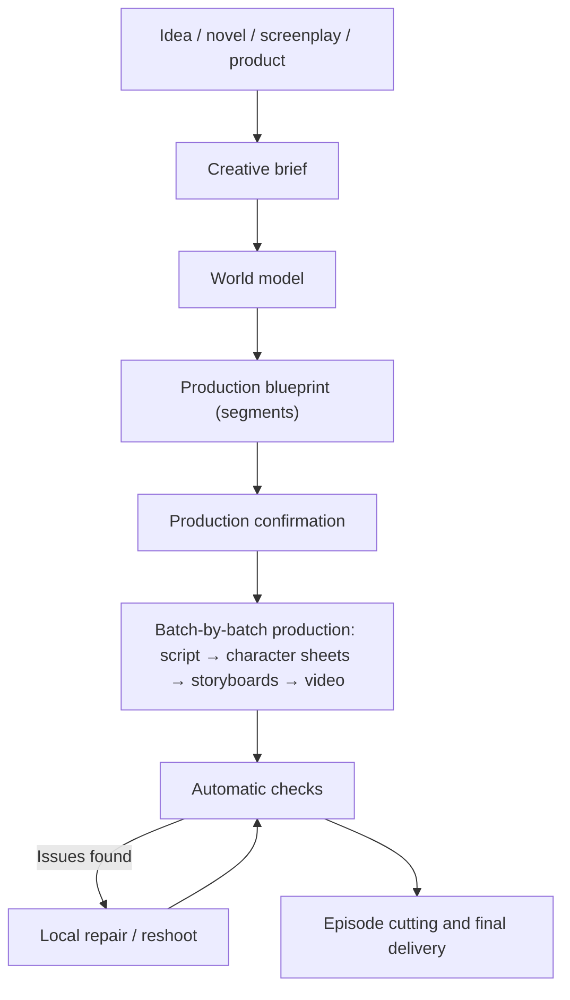

# クリエイティブワークフロー {#workflows}

監督として、作りたい映像を伝えてください。Zaiが制作計画をまとめ、各セグメントの生成・確認・修正を進めて動画を完成させます。このページでは、制作の流れ、確認が必要な場面、作品の一貫性を保つ方法を説明します。

## 1. 概要 {#overview}

- プロジェクトには、プランの検討から最終カットまでを一貫して行う単一のZai会話があります。「創作段階」と「制作段階」でアシスタントが分かれることはありません。
- プラットフォームは目標達成に必要なステップのみを生成し、既に利用可能な成果物を再生成することはありません。
- プロセス全体が可視化され、各ステップの内容、コスト、生成物はすべて会話とワークスペースに記録されます。

## 2. 会話からプロジェクトへ {#conversation-to-project}

ホームページで最初のメッセージを送信すると（任意で画像や小説・脚本ファイルを添付可能）、プラットフォームがプロジェクトを作成し、プロジェクトページを開きます。プロジェクトの作成、原典テキストの分析、プランの検討は無料です。

小説や脚本を提供した場合、Zaiは最初に**脚本レビュー**を実行します。最大5つのストーリー上の問題点（欠落エピソード、プロットの穴、役割が不明確なキャラクター、伏線のない展開など）を、元の該当箇所と修正案とともに提示し、適用するかどうかを判断します。承認された変更は脚色要件に反映されるか、新しい原典テキストとして整理されます。

小説や脚本の取り込み後、Zaiはストーリーに基づいてプロジェクトスタイル（フォトリアリスティック、3Dドラマ、2Dドラマ）も推奨します。フォトリアリスティックがデフォルトで、プロジェクト設定で変更できます。

## 3. コンテンツソース {#content-sources}

### 3.1 小説 {#source-novel}

小説の脚色、Web小説のまとめ動画、AIによる話分割が必要なプロジェクトに適しています。Zaiはキャラクターとその別名、重要なシーンや小道具、ストーリーの局面、テキストを分割できるエピソードの区切りを特定します。

推奨事項：

- 初回に長編小説全体をアップロードせず、まず完結したストーリーアークを形成する章でスタイルを検証してください。
- キャラクターシートが確定してから制作範囲を拡大してください。

### 3.2 完成した脚本 {#source-screenplay}

既に台詞、ナレーション、シーン描写があり、原稿を可能な限り忠実に保ちたいプロジェクトに適しています。原則は以下のとおりです。

- 台詞とナレーションは可能な限り原文に忠実に保ちます。
- キャラクターは作者の配役リストと脚本に基づきます。
- 台詞のある脇役やエキストラ（例：「客A」）、セグメントをまたいで繰り返し登場する無名の人物はキャラクターとして登録し、一度だけ登場する台詞のない群衆はショットの説明にのみ記載し、キャラクターアセットとして膨らませません。
- 焦点は書き直しではなく、正規化とショット制作です。

### 3.3 製品資料 {#source-product-material}

製品プロモーション動画、製品デモ、短いブランド動画に適しています。以下を準備します。

- 製品の正面・側面・ディテール・使用中の画像
- 主要なセールスポイント、ターゲットオーディエンス、使用してはならない表現
- ブランドのビジュアル要件、目標尺、公開プラットフォーム

製品はワールドモデルに製品アセットとして保存され、プロジェクトに「製品」ページが表示されます。まず安定した製品リファレンス画像を確立し、その後にシナリオベースのセグメントを生成します。

## 4. 3層プラン {#creative-plan}

Zaiはリクエストを3層のプランに整理します。いつでも変更を依頼できます。

| 層 | 内容 |
| --- | --- |
| クリエイティブブリーフ | 意図、目標、オーディエンス、プラットフォーム、尺、トーン、原典資料、ブランド要件、行動喚起、ハード制約。「物語を語る」と「製品を見せる」のように複数の意図が共存できます |
| ワールドモデル | キャラクター、シーン、小道具、製品、ビジュアルスタイル、連続性ルール |
| 制作ブループリント | セグメントの集合。各セグメントはタイプ、担う意図、必要な機能、尺、画面上のキャラクター、ビジュアル・音声の指示を宣言します |

### 4.1 キャラクターとルック {#characters-and-looks}

キャラクターは1つのアイデンティティと1つ以上の**ルック**で構成されます。顔と体はアイデンティティに属し、すべてのルックで共有されます。服装、髪型、アクセサリーはルックに属します。

- プライマリルックのキャラクターシートがキャラクターのアイデンティティの基準となり、各バリエーションルックはそれを参照として独自のキャラクターシートを持ちます。
- 各セグメントでどのルックを着用するかは、脚本セグメントが明示的に選択します。キャラクターに複数のルックがあり、セグメントが1つも選択していない場合、そのセグメントはプライマリルックへ自動的にフォールバックせず、脚本ステップで停止します。
- プライマリルックのキャラクターシートを描き直すと、バリエーションのキャラクターシートは古くなります。影響范围が先に提示されます。

### 4.2 セグメントタイプ {#segment-grammar}

各セグメントにはタイプがあり、1つのプロジェクトで複数のタイプを組み合わせられます。

| タイプ | 適している用途 |
| --- | --- |
| パフォーマンス | キャラクターの台詞と行動が物語を進める |
| ナレーション | 画面外の声が語り、映像が物語と雰囲気を支える |
| ショーケース | 製品やオブジェクトの外観を強調する |
| デモ | 使用方法やプロセスを示す |
| インタビュー | 人物が質問に答える |
| トーキングヘッド | 人物がカメラに向かって直接話す |
| モンタージュ | 多くのショットを素早く組み合わせ、時間の経過や感情を伝える |
| ミュージックビジュアル | 音楽のリズムに合わせて映像を構成する |

プロジェクトには「ストーリーテリングモード」「ドラマモード」「広告モード」といった個別のモードはありません。1つのエピソードにパフォーマンスセグメントとナレーション、ショーケースセグメントを共存させられます。

## 5. セグメントの2つの動画生成方式 {#video-production-routes}

各セグメントは動画生成方式を1つだけ選択します。Zaiがブループリントでセグメントごとに決定し、プロジェクトレベルの切り替えではなく、「作成後に変更不可」という制限もありません。

### 5.1 絵コンテガイド方式 {#storyboard-image-route}

まずセグメントの絵コンテ画像を生成し、その絵コンテ画像を最初のフレームとして動画を生成します。

- 構図の制御が最も容易で、絵コンテを確認することで問題を早期に発見できます。
- 隣接する絵コンテは前のセグメントのフレームを参照するため、連続性の維持に役立ちます。
- 台詞シーンや、正確なブロッキングと構図が必要なセグメントに適しています。

同じシーケンス内の複数の絵コンテを1つのグリッド絵コンテにまとめ、まとめて生成してから各セグメントの絵コンテに切り分けることもできます。グリッド絵コンテは絵コンテ画像を生成する1つの方法であり、プラットフォームが必要に応じて有効にします。ショット数に基づいて自動的に2×2または3×3を使用し、各セルはプロジェクトのアスペクト比に合わせます。より密度の高い4×4 / 5×5グリッドは、画像解像度が4Kの場合のみ使用されます。セルが増えると各セルが小さくなり、動画品質が低下するためです。グリッド絵コンテは絵コンテガイド方式のセグメントにのみ適用されます。

### 5.2 リファレンスガイド方式 {#reference-video-route}

絵コンテは生成せず、ワールドモデル内のキャラクター、シーン、小道具、製品のリファレンス画像を直接動画モデルに渡します。

- ステップが少なく、キャラクターや製品のアイデンティティをより直接的に固定できます。
- 絵コンテガイド方式より構図の制御は劣ります。
- モデルの複数リファレンス機能に依存し、リファレンス画像の数と種類はモデルによって異なります。

製品ショーケースや、アイデンティティの一貫性が最優先で構図要件が控えめなセグメントに適しています。

## 6. 音声 {#voice-and-audio}

- **台詞**: 音声は動画モデルが直接生成します。
- **ナレーション**: プロジェクトには統一されたナレーション提供方法が1つあり、「プロジェクト情報」のエピソードパラメータで選択します。
  - **ポストプロダクションで吹き替え**（デフォルト）: 最終カットにナレーション音声は含まれず、書き出し後に自身で録音します。
  - **TTS音声**: プラットフォームがナレーションセグメントの音声を合成します。プロジェクト設定でナレーションの音声モデル、声、速度を選択できます。
- TTSはナレーションテキストのあるセグメントにのみ適用されます。バッチがすべて台詞の場合、TTSオプションは表示されません。
- プラットフォームはBGMを生成しません。

## 7. 制作の開始と実行 {#production-stages}

### 7.1 制作確認 {#production-start}

プランの準備が整うと、Zaiは制作見積もりを提示します。セグメント数、動画の秒数、絵コンテ数、リファレンスシート数、現在の残高、含まれない項目が示されます。承認すると、予算がプロジェクトの会話に記録され、その予算内のステップが自動的に実行されます。

一部の作業から開始することもできます。例えば「まず第1話を撮影」「最初の2セグメントだけ撮影」と指定すると、見積もりはそれらのセグメントのみを対象とし、以降のステップもその範囲内に留まります。その部分が完了したら、Zaiに残りを続行するよう伝えます。

### 7.2 バッチとエピソード {#batches-and-episodes}

- **バッチ**は制作の単位です。プラットフォームがセグメントを複数のバッチに分割し、あるバッチの脚本、絵コンテ、動画がすべて完了すると、次のバッチに進みます。
- **セグメント**はバッチ内で最小の制作単位です。
- **エピソード**は納品の単位です。プラットフォームはターゲット尺に従ってセグメントシーケンスから各エピソードをカットし、可能な場合はエピソード末尾のフックで区切ります。エピソードはすべてのセグメントが揃って初めて組み立てられ、公開済みのエピソード境界は固定されます。

ワークスペースの「ダッシュボード」には5つのステーション（「プランと脚本 / リファレンスシート / 絵コンテ / 動画 / 最終カット」）の進捗が表示され、「バッチ」ページではバッチごとにプレビュー、レビュー、修正ができます。

## 8. 成果物のステータス {#artifact-currency}

プラットフォームは、成果物が生成されたときの入力に基づいてステータスを判断します。

- **current（最新）**: 現在のプラン、脚本、選択済みバージョンと一致しています。
- **stale（古い）**: 成果物は引き続きプレビューと書き出しが可能ですが、生成後に関連する入力が変更されています。
- **missing（欠落）**: 使用可能な成果物がまだなく、生成が必要です。
- **blocked（ブロック）**: リファレンスやレコードに先に修正すべき問題があります。プラットフォームはこれを欠落として扱い、自動的に支払って再生成することはありません。

バッチ生成は、デフォルトでは欠落項目のみを補います。currentとstaleの成果物はどちらも保持されます。プロンプト、キャラクター、脚本を変更すると、インターフェースに「現在のコンテンツより古い」成果物の数が表示されます。特定のセグメントを更新するには、会話でZaiに再撮影を依頼します。自動チェックで Blocker 問題があると判断された成果物は、ステータスがcurrentまたはstaleであっても使用可能な結果とは見なされません。

## 9. 自動チェックと修復 {#checks-and-repair}

各メディア成果物の生成後、プラットフォームが自動的にチェックします。判定は合格、不合格、スキップ（比較対象がない場合など）のいずれかです。スキップが合格として扱われることはありません。

| チェック | レベル | 説明 |
| --- | --- | --- |
| メディア整合性 | Blocker | ファイルのトラックまたは長さがリクエストと一致しない |
| 黒フレーム | Blocker | 完全な黒フレームの割合が大きすぎる |
| 絵コンテアンカー | Blocker | 動画の最初のフレームが絵コンテ画像とほぼ無関係 |
| 無音 | Warning | 音声の大部分が無音 |
| キャラクターの存在 | Warning | 登場すべきキャラクターがフレーム内にいない |
| キャラクターシートのレイアウト | Warning | キャラクターシートが必要なレイアウトに従っていない |
| 機械的な脚色 | Warning | 脚本の脚色が原典テキストを機械的にコピーしすぎている |

Blockerレベルで確定的な失敗のみが成果物を使用不能にします。不合格となった動画・音声チェックは自動的に修復されます。各修復では入力を変更し（例：新しいランダムシード、より強いリファレンス、短い尺）、同じ問題が修復回数の上限に達すると修復を停止し、判断をユーザーに委ねます。キャラクターシートのレイアウトと機械的な脚色は、シードの変更で必ず修正されるとは限らないため、再生成するか修正するかの判断が直接ユーザーに委ねられます。

セグメントを自発的に再撮影することもできます。会話で対象セグメントと変更内容を伝えると、Zaiが変更前→変更後の比較を表示します。確認後、そのセグメントのみが作り直されます。再撮影と修復には、制作予算とは別のリワーク予算が使用されます。「候補レビュー」では、同じセグメントの候補バージョンがスコア順に一覧表示され、1つを選択して固定する、差し戻す、別のものを生成する、のいずれかが可能です。

## 10. 確認ポイント {#review-gates}

Zaiはデフォルトで自動的に進行し、次の2種類の状況でのみ確認を求めます。

| 状況 | 例 |
| --- | --- |
| 費用の支出、または取り消し不能なリソース消費を伴う場合 | 制作見積もり、制作予算を超えるステップ、リワーク予算の不足、制作の中止またはロールバック |
| 既に行った作業を上書きする場合 | 手動で編集した脚本の書き直し、既存のビジュアルスタイルやアセット定義の上書き、キャラクターシートが既にあるルックの削除 |

原典テキストの分析、アセットの整理、バッチ計画、脚本の初回作成、タイトルやあらすじの変更などのアクションは直接実行され、完了時にZaiが通知します。確認はチャット入力欄の上に表示され、費用を伴う確認には常にUSDでの金額が表示されます。確認カードが表示されている間に新しいメッセージを送信すると、そのカードは無効となり、Zaiは新しいリクエストでやり直します。

## 11. 一貫性のための実践 {#consistency-practices}

### キャラクター {#consistency-characters}

- 年齢、髪型、体格、主要な服装の説明を固定します。
- 異なる主要キャラクターには明確に区別できる特徴を持たせます。
- ストーリー上、衣装替えが必要な場合は、プロンプトでその場限りに説明するのではなく、ルックを追加して脚本でセグメントごとに選択します。

### シーン {#consistency-scenes}

- 重要なシーンにはリファレンスアセットを作成し、空間レイアウトと主要な調度品を固定します。
- 同じストーリー区間内では、照明や時間帯の不要な頻繁な変更を避けます。

### 小道具と製品 {#consistency-props}

- ストーリーの鍵となるアイテムには小道具アセットを作成します。
- 製品には複数角度からの実写写真を優先します。
- 重要なテキスト、ロゴ、構造をモデルに独自に補完させないでください。
- 細部のずれに気づいたら、後のセグメントでごまかさず、該当セグメントを再撮影します。

## 12. リワークの抑制 {#cost-control-practices}

- まず数セグメントを撮影してスタイルを検証し、その後で範囲を拡大します。
- 絵コンテや動画を大量に生成する前に、キャラクターシートとルックを確定します。
- 1つのセグメントに問題がある場合は、エピソード全体を再起動せず、そのセグメントのみを再撮影します。
- 保持したいバージョンには速やかに「現在のバージョンを固定」を使用し、再生成による置き換えを防ぎます。

## 13. 完了の定義 {#definition-of-done}

エピソードまたは短編動画は、少なくとも以下の条件を満たした場合にのみ完了と見なされます。

- プランと脚本が確定している。
- 主要キャラクターのキャラクターシートとルックが確定している。
- Blockerレベルのチェック失敗があるセグメントが存在しない。
- キャラクターと製品に明らかなアイデンティティのずれがなく、セグメントが自然につながっている。
- ナレーションと字幕の校正が済んでいる。
- 最終動画が正常に再生・ダウンロードできる。
