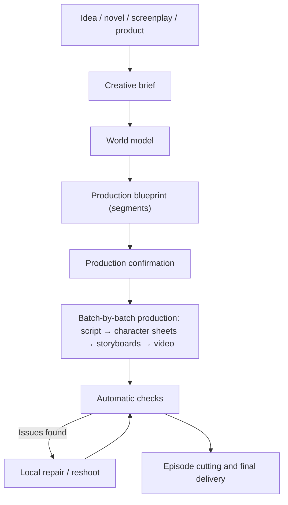

# Quy trình sáng tạo {#workflows}

Bạn đóng vai trò đạo diễn và mô tả kết quả mong muốn. Zai giúp lập kế hoạch sản xuất, sau đó tạo, kiểm tra và chỉnh sửa từng phân đoạn để hoàn thành video. Trang này hướng dẫn quy trình, những bước cần bạn xác nhận và cách giữ tính nhất quán cho tác phẩm.

## 1. Tổng quan {#overview}

- Một dự án có một cuộc trò chuyện Zai duy nhất chạy từ khi thảo luận kế hoạch cho đến bản cắt cuối cùng. Không có trợ lý "giai đoạn sáng tạo" và "giai đoạn sản xuất" riêng biệt.
- Nền tảng chỉ tạo ra các bước cần thiết để đạt được mục tiêu; những tạo phẩm đã dùng được sẽ không được tạo lại.
- Toàn bộ quy trình đều hiển thị với bạn: mỗi bước đã làm gì, chi phí bao nhiêu và tạo ra sản phẩm gì đều được ghi lại trong cuộc trò chuyện và không gian làm việc.

## 2. Từ cuộc trò chuyện đến dự án {#conversation-to-project}

Khi bạn gửi tin nhắn đầu tiên trên trang chủ (tùy chọn kèm theo hình ảnh và các tệp tiểu thuyết / kịch bản), nền tảng sẽ tạo dự án và mở trang dự án. Việc tạo dự án, phân tích văn bản nguồn và thảo luận kế hoạch là miễn phí.

Nếu bạn cung cấp tiểu thuyết hoặc kịch bản, trước tiên Zai sẽ chạy **rà soát kịch bản**: liệt kê tối đa 5 vấn đề về câu chuyện (thiếu tập, lỗ hổng cốt truyện, nhân vật không có vai trò rõ ràng, tình tiết bất ngờ thiếu nền tảng, v.v.), mỗi vấn đề đều kèm theo đoạn văn gốc và đề xuất sửa đổi, và bạn quyết định có áp dụng chúng hay không. Các thay đổi được chấp nhận sẽ được ghi vào yêu cầu chuyển thể, hoặc được viết thành văn bản nguồn mới.

Sau khi nhập tiểu thuyết hoặc kịch bản, Zai cũng đề xuất một phong cách dự án dựa trên câu chuyện — Chân thực, Chính kịch 3D, hoặc Chính kịch 2D. Chân thực là mặc định; bạn có thể thay đổi trong cài đặt dự án.

## 3. Nguồn nội dung {#content-sources}

### 3.1 Tiểu thuyết {#source-novel}

Phù hợp với chuyển thể tiểu thuyết, video tóm tắt web-tiểu thuyết và các dự án cần AI hỗ trợ chia tập. Zai xác định nhân vật và biệt danh của họ, cảnh và đạo cụ chính, các giai đoạn câu chuyện và ranh giới tập nơi văn bản có thể được chia tách.

Khuyến nghị:

- Đừng tải lên toàn bộ một cuốn tiểu thuyết dài ngay lần đầu; hãy xác thực phong cách trước bằng một chương tạo thành một mạch truyện khép kín;
- Chỉ mở rộng phạm vi sản xuất sau khi hồ sơ nhân vật được xác nhận.

### 3.2 Kịch bản hoàn chỉnh {#source-screenplay}

Phù hợp với các dự án đã có lời thoại, lời dẫn và mô tả cảnh, và muốn giữ nguyên bản thảo gốc nhất có thể. Các nguyên tắc là:

- Giữ lời thoại và lồng tiếng gần như nguyên văn nhất có thể;
- Xây dựng nhân vật dựa trên danh sách diễn viên và kịch bản của tác giả;
- Nhân vật phụ và diễn viên quần chúng có lời thoại (ví dụ "Khách A"), cũng như những người không tên xuất hiện lặp lại qua các phân đoạn, được đăng ký thành nhân vật; đám đông chỉ xuất hiện một lần không có lời thoại chỉ được viết vào mô tả cảnh quay và không bị thổi phồng thành tài sản nhân vật;
- Trọng tâm là chuẩn hóa và sản xuất cảnh quay, không phải viết lại.

### 3.3 Tài liệu sản phẩm {#source-product-material}

Phù hợp với video ngắn quảng bá sản phẩm, video giới thiệu sản phẩm và video thương hiệu ngắn. Chuẩn bị:

- Hình ảnh mặt trước, mặt bên, chi tiết và đang sử dụng của sản phẩm;
- Điểm bán hàng cốt lõi, đối tượng mục tiêu và các tuyên bố không được phép xuất hiện;
- Yêu cầu hình ảnh thương hiệu, thời lượng mục tiêu và nền tảng xuất bản.

Sản phẩm được lưu dưới dạng tài sản sản phẩm trong mô hình thế giới và trang "Sản phẩm" xuất hiện trong dự án. Thiết lập hình ảnh tham chiếu sản phẩm ổn định trước, sau đó tạo các phân đoạn theo kịch bản.

## 4. Kế hoạch ba lớp {#creative-plan}

Zai tổ chức yêu cầu của bạn thành một kế hoạch ba lớp, và bạn có thể yêu cầu thay đổi bất cứ lúc nào:

| Lớp | Nội dung |
| --- | --- |
| Tóm tắt sáng tạo | Ý định, mục tiêu, khán giả, nền tảng, thời lượng, giọng điệu, tài liệu nguồn, yêu cầu thương hiệu, lời kêu gọi hành động và các ràng buộc cứng. Nhiều ý định có thể cùng tồn tại, ví dụ "kể một câu chuyện" đồng thời "trưng bày một sản phẩm" |
| Mô hình thế giới | Nhân vật, bối cảnh, đạo cụ, sản phẩm, phong cách hình ảnh và các quy tắc liên tục |
| Bản thiết kế sản xuất | Một tập hợp các phân đoạn; mỗi phân đoạn khai báo loại, ý định phục vụ, khả năng cần thiết, thời lượng, nhân vật trên màn hình và chỉ đạo hình ảnh và âm thanh |

### 4.1 Nhân vật và tạo hình {#characters-and-looks}

Một nhân vật là một danh tính cộng với một hoặc nhiều **tạo hình**: khuôn mặt và cơ thể thuộc về danh tính và được chia sẻ bởi tất cả các tạo hình; quần áo, kiểu tóc và phụ kiện thuộc về một tạo hình.

- Hồ sơ nhân vật của tạo hình chính là mỏ neo danh tính của nhân vật; mỗi tạo hình biến thể có hồ sơ nhân vật riêng sử dụng nó làm tham chiếu.
- Tạo hình nào được mặc trong mỗi phân đoạn được chọn rõ ràng bởi phân đoạn kịch bản. Nếu một nhân vật có nhiều tạo hình và phân đoạn chưa chọn một tạo hình, phân đoạn đó sẽ dừng ở bước kịch bản thay vì tự động quay về tạo hình chính.
- Vẽ lại hồ sơ nhân vật của tạo hình chính làm cho các hồ sơ nhân vật biến thể trở nên lỗi thời; phạm vi bị ảnh hưởng sẽ được liệt kê cho bạn trước.

### 4.2 Các loại phân đoạn {#segment-grammar}

Mỗi phân đoạn có một loại, và một dự án có thể kết hợp nhiều loại:

| Loại | Phù hợp với |
| --- | --- |
| Diễn xuất | Lời thoại và hành động của nhân vật thúc đẩy câu chuyện |
| Lồng tiếng | Một giọng nói ngoài màn hình kể chuyện; hình ảnh phục vụ câu chuyện và bầu không khí |
| Trưng bày | Làm nổi bật diện mạo của sản phẩm hoặc đồ vật |
| Trình diễn | Cho thấy cách sử dụng một thứ gì đó hoặc một quy trình |
| Phỏng vấn | Một người trả lời câu hỏi |
| Đầu biết nói | Một người nói trực tiếp với máy quay |
| Dựng cảnh nhanh | Nhiều cảnh quay kết hợp nhanh để truyền tải một khoảng thời gian hoặc một cảm xúc |
| Hình ảnh âm nhạc | Hình ảnh được tổ chức theo nhịp điệu âm nhạc |

Các dự án không có "chế độ kể chuyện", "chế độ chính kịch" hay "chế độ quảng cáo" riêng biệt. Một tập phim có thể chứa các phân đoạn diễn xuất cùng với các phân đoạn lồng tiếng và trưng bày.

## 5. Hai phương pháp tạo video cho phân đoạn {#video-production-routes}

Mỗi phân đoạn chọn đúng một phương pháp tạo video. Zai quyết định điều đó cho từng phân đoạn trong bản thiết kế; đây không phải là công tắc cấp dự án, và không có hạn chế "không thể thay đổi sau khi tạo".

### 5.1 Hướng dẫn bằng bảng phân cảnh {#storyboard-image-route}

Các hình ảnh bảng phân cảnh được tạo cho phân đoạn trước, sau đó video được tạo bằng cách sử dụng hình ảnh bảng phân cảnh làm khung hình đầu tiên.

- Bố cục có thể kiểm soát tốt nhất, và việc xem lại bảng phân cảnh giúp phát hiện sớm vấn đề;
- Các bảng phân cảnh liền kề tham chiếu đến khung hình của phân đoạn trước, giúp duy trì tính liên tục;
- Phù hợp với các cảnh đối thoại và các phân đoạn cần bố trí và bố cục chính xác.

Nhiều bảng phân cảnh trong cùng một chuỗi cũng có thể được kết hợp thành một bảng phân cảnh lưới, được tạo cùng nhau, rồi cắt thành bảng phân cảnh của từng phân đoạn. Bảng phân cảnh lưới là một cách tạo hình ảnh bảng phân cảnh, và nền tảng kích hoạt nó khi cần: nó tự động sử dụng 2×2 hoặc 3×3 dựa trên số lượng cảnh quay, với mỗi ô khớp với tỷ lệ khung hình của dự án; lưới dày đặc hơn 4×4 / 5×5 chỉ được sử dụng khi độ phân giải hình ảnh là 4K, vì nhiều ô hơn nghĩa là các ô nhỏ hơn, làm giảm chất lượng video. Bảng phân cảnh lưới chỉ áp dụng cho các phân đoạn được hướng dẫn bằng bảng phân cảnh.

### 5.2 Hướng dẫn bằng tham chiếu {#reference-video-route}

Không tạo bảng phân cảnh; các hình ảnh tham chiếu của nhân vật, bối cảnh, đạo cụ hoặc sản phẩm từ mô hình thế giới được truyền trực tiếp cho mô hình video.

- Ít bước hơn, và neo trực tiếp hơn vào danh tính nhân vật hoặc sản phẩm;
- Bố cục khó kiểm soát hơn so với tạo theo bảng phân cảnh;
- Nó phụ thuộc vào khả năng đa tham chiếu của mô hình; số lượng và loại hình ảnh tham chiếu thay đổi theo từng mô hình.

Phù hợp với các phân đoạn trưng bày sản phẩm và các phân đoạn mà tính nhất quán danh tính được ưu tiên hàng đầu và yêu cầu bố cục khiêm tốn.

## 6. Âm thanh {#voice-and-audio}

- **Lời thoại**: giọng nói được tạo trực tiếp bởi mô hình video.
- **Lời dẫn**: một dự án có một phương thức truyền tải lời dẫn thống nhất, bạn chọn trong Tham số Tập dưới mục "Thông tin dự án":
  - **Lồng tiếng hậu kỳ** (mặc định): bản cắt cuối cùng không chứa giọng lời dẫn, và bạn tự ghi âm lồng tiếng sau khi xuất;
  - **Giọng TTS**: nền tảng tổng hợp giọng lồng tiếng cho các phân đoạn lời dẫn; bạn có thể chọn mô hình giọng lời dẫn, giọng đọc và tốc độ trong cài đặt dự án.
- TTS chỉ áp dụng cho các phân đoạn có văn bản lời dẫn; khi một lô toàn là lời thoại, tùy chọn TTS sẽ không xuất hiện.
- Nền tảng không tạo nhạc nền.

## 7. Bắt đầu và vận hành sản xuất {#production-stages}

### 7.1 Xác nhận sản xuất {#production-start}

Khi kế hoạch đã sẵn sàng, Zai đưa ra báo giá sản xuất: số lượng phân đoạn, số giây video, số lượng bảng phân cảnh, số lượng hồ sơ tham chiếu, số dư hiện tại và bất kỳ thứ gì không được bao gồm. Sau khi bạn phê duyệt, ngân sách được ghi lại trên cuộc trò chuyện dự án, và các bước trong ngân sách đó chạy tự động.

Bạn có thể bắt đầu chỉ với một phần công việc, ví dụ "quay tập 1 trước" hoặc "chỉ quay hai phân đoạn đầu tiên"; báo giá chỉ bao gồm những phân đoạn đó, và mọi bước tiếp theo đều nằm trong phạm vi đó. Khi phần đó hoàn tất, hãy bảo Zai tiếp tục với phần còn lại.

### 7.2 Lô và tập {#batches-and-episodes}

- **Lô** là đơn vị sản xuất: nền tảng chia các phân đoạn thành nhiều lô, và khi kịch bản, bảng phân cảnh và video của một lô đều hoàn tất, nó chuyển sang lô tiếp theo.
- **Phân đoạn** là đơn vị sản xuất nhỏ nhất trong một lô.
- **Tập** là đơn vị bàn giao: nền tảng cắt mỗi tập từ chuỗi phân đoạn theo thời lượng mục tiêu, kết thúc ở điểm kết tập khi có thể; một tập chỉ được lắp ráp khi tất cả các phân đoạn của nó đã sẵn sàng, và các ranh giới tập đã phát hành sẽ bị đóng băng.

Trang "Tổng quan" của không gian làm việc hiển thị tiến độ trên năm trạm — "Kế hoạch và kịch bản / Hồ sơ tham chiếu / Bảng phân cảnh / Video / Bản cắt cuối" — và trang "Lô" cho phép bạn xem trước, xem lại và chỉnh sửa từng lô.

## 8. Trạng thái tạo phẩm {#artifact-currency}

Nền tảng xác định trạng thái của một tạo phẩm từ các đầu vào mà nó được tạo ra:

- **hiện hành**: nhất quán với kế hoạch, kịch bản và các phiên bản đã chọn hiện tại;
- **lỗi thời**: tạo phẩm vẫn có thể được xem trước và xuất, nhưng các đầu vào liên quan đã thay đổi kể từ khi nó được tạo;
- **thiếu**: chưa có tạo phẩm dùng được và cần được tạo;
- **bị chặn**: một tham chiếu hoặc hồ sơ có vấn đề phải được sửa trước; nền tảng sẽ không coi nó là thiếu và tự động trả tiền để tạo lại.

Việc tạo lô chỉ lấp đầy các mục thiếu theo mặc định; cả tạo phẩm hiện hành và lỗi thời đều được giữ lại. Sau khi bạn thay đổi lời nhắc, nhân vật hoặc kịch bản, giao diện hiển thị có bao nhiêu tạo phẩm "cũ hơn nội dung hiện tại"; để làm mới một phân đoạn cụ thể, hãy yêu cầu Zai quay lại phân đoạn đó trong cuộc trò chuyện. Một tạo phẩm mà các kiểm tra tự động đánh giá có vấn đề Cấp độ Chặn không được coi là kết quả dùng được, ngay cả khi trạng thái của nó là hiện hành hoặc lỗi thời.

## 9. Kiểm tra và sửa chữa tự động {#checks-and-repair}

Sau khi mỗi tạo phẩm phương tiện được tạo, nền tảng sẽ tự động kiểm tra nó. Phán quyết là đạt, không đạt hoặc bỏ qua (ví dụ, khi không có gì để so sánh); một lần bỏ qua không bao giờ bị qua mặt như một lần đạt.

| Kiểm tra | Cấp độ | Mô tả |
| --- | --- | --- |
| Tính toàn vẹn phương tiện | Chặn | Các rãnh hoặc thời lượng của tệp không khớp với yêu cầu |
| Khung hình đen | Chặn | Các khung hình đen hoàn toàn chiếm tỷ lệ quá lớn |
| Neo bảng phân cảnh | Chặn | Khung hình đầu tiên của video về cơ bản không liên quan đến hình ảnh bảng phân cảnh |
| Im lặng | Cảnh báo | Phần lớn âm thanh bị im lặng |
| Sự hiện diện nhân vật | Cảnh báo | Một nhân vật đáng lẽ phải xuất hiện lại không có trong khung hình |
| Bố cục hồ sơ nhân vật | Cảnh báo | Hồ sơ nhân vật không tuân theo bố cục yêu cầu |
| Chuyển thể máy móc | Cảnh báo | Phần chuyển thể kịch bản sao chép văn bản nguồn quá máy móc |

Chỉ một thất bại xác định ở cấp độ Chặn mới khiến tạo phẩm không dùng được. Các kiểm tra video và âm thanh không đạt được sửa chữa tự động: mỗi lần sửa chữa thay đổi các đầu vào (ví dụ: hạt giống ngẫu nhiên mới, tham chiếu mạnh hơn, hoặc thời lượng ngắn hơn), và khi cùng một vấn đề đạt đến giới hạn sửa chữa, việc sửa chữa dừng lại và quyết định được trao lại cho bạn. Bố cục hồ sơ nhân vật và chuyển thể máy móc không nhất thiết được sửa bằng cách thay đổi hạt giống, vì vậy chúng đi thẳng đến bạn để quyết định tạo lại hay chỉnh sửa.

Bạn cũng có thể chủ động quay lại một phân đoạn: nói trong cuộc trò chuyện phân đoạn nào và thay đổi như thế nào, và Zai hiển thị so sánh cũ → mới của thay đổi; sau khi bạn xác nhận, chỉ phân đoạn đó được làm lại. Các lần quay lại và sửa chữa sử dụng ngân sách làm lại tách biệt với ngân sách sản xuất. "Xem xét ứng viên" liệt kê các phiên bản ứng viên của cùng một phân đoạn theo điểm số, và bạn có thể chọn và ghim một phiên bản, gửi trả lại, hoặc tạo một phiên bản khác.

## 10. Các điểm xác nhận {#review-gates}

Zai tiến về phía trước một cách tự động theo mặc định và chỉ dừng lại để xin xác nhận của bạn trong hai loại tình huống:

| Tình huống | Ví dụ |
| --- | --- |
| Tiêu tiền hoặc tiêu thụ tài nguyên không thể đảo ngược | Báo giá sản xuất, các bước vượt quá ngân sách sản xuất, ngân sách làm lại không đủ, hủy bỏ hoặc quay lui sản xuất |
| Ghi đè công việc bạn đã thực hiện | Viết lại kịch bản bạn đã chỉnh sửa bằng tay, ghi đè một phong cách hình ảnh hoặc định nghĩa tài sản hiện có, xóa một tạo hình đã có hồ sơ nhân vật |

Các hành động như phân tích văn bản nguồn, sắp xếp tài sản, lập kế hoạch lô, viết kịch bản lần đầu và thay đổi tiêu đề cũng như tóm tắt chạy trực tiếp, và Zai cho bạn biết khi chúng hoàn tất. Xác nhận diễn ra ngay phía trên ô nhập trò chuyện, và bất kỳ xác nhận nào tiêu tiền luôn hiển thị số tiền bằng USD; nếu bạn gửi một tin nhắn mới trong khi thẻ xác nhận đang hiển thị, thẻ đó bị vô hiệu và Zai bắt đầu lại với yêu cầu mới.

## 11. Các thực hành nhất quán {#consistency-practices}

### Nhân vật {#consistency-characters}

- Giữ cố định mô tả về tuổi, kiểu tóc, vóc dáng và trang phục cốt lõi;
- Cho các nhân vật chính khác nhau những đặc điểm dễ phân biệt rõ ràng;
- Khi câu chuyện cần thay trang phục, hãy thêm một tạo hình và chọn nó theo từng phân đoạn trong kịch bản, thay vì mô tả tùy tiện trong các lời nhắc.

### Bối cảnh {#consistency-scenes}

- Tạo tài sản tham chiếu cho các bối cảnh quan trọng, cố định bố cục không gian và đồ nội thất chính;
- Trong cùng một mạch truyện, tránh thay đổi ánh sáng và thời gian trong ngày thường xuyên, không cần thiết.

### Đạo cụ và sản phẩm {#consistency-props}

- Tạo tài sản đạo cụ cho các vật phẩm quan trọng đối với câu chuyện;
- Đối với sản phẩm, ưu tiên ảnh chụp thật từ nhiều góc độ;
- Không để mô hình tự điền văn bản, logo hoặc cấu trúc quan trọng;
- Khi bạn nhận thấy các chi tiết bị trôi lệch, hãy quay lại phân đoạn tương ứng thay vì che đậy bằng các phân đoạn sau.

## 12. Kiểm soát việc làm lại {#cost-control-practices}

- Quay thử vài phân đoạn trước để xác thực phong cách, sau đó mới mở rộng phạm vi;
- Xác nhận hồ sơ nhân vật và tạo hình trước khi tạo hàng loạt bảng phân cảnh và video;
- Nếu một phân đoạn gặp vấn đề, chỉ quay lại phân đoạn đó thay vì khởi động lại toàn bộ tập;
- Sử dụng "Ghim phiên bản hiện tại" kịp thời cho các phiên bản bạn muốn giữ, để chúng không bị thay thế bằng việc tạo lại.

## 13. Định nghĩa hoàn thành {#definition-of-done}

Một tập phim hoặc video ngắn chỉ được tính là hoàn thành khi đáp ứng ít nhất các điều kiện sau:

- Kế hoạch và kịch bản đã được xác nhận;
- Hồ sơ nhân vật và tạo hình của các nhân vật chính đã được xác nhận;
- Không có phân đoạn nào có lỗi kiểm tra ở cấp độ Chặn;
- Nhân vật và sản phẩm không có sự trôi lệch danh tính rõ ràng, và các phân đoạn chuyển tiếp tự nhiên vào nhau;
- Lời dẫn và phụ đề đã được hiệu đính;
- Video cuối cùng phát và tải xuống bình thường.
