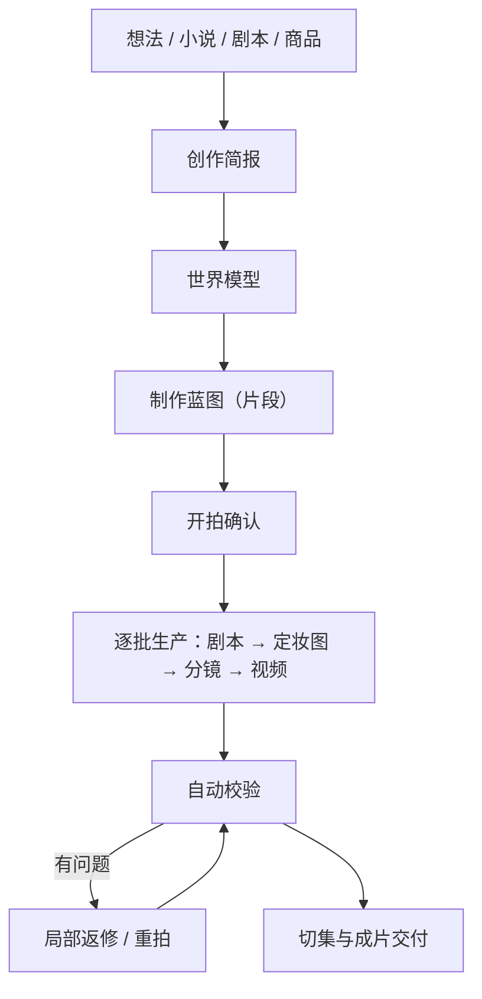

# 創作流程 {#workflows}

你以導演身份描述想要的成果，Zai 協助整理製作方案，再按方案逐段生成、檢查及修改，直至交付成片。本頁說明製作流程、需要你確認的環節，以及提升作品一致性的方法。

## 1. 流程總覽 {#overview}

- 一個項目只有一條 Zai 對話，從討論方案一直延續到成片，不存在「創建階段」和「生產階段」兩個助手。
- 平台只生成達成目標所必需的步驟；已經可用的產物不會重複生成。
- 全過程對你可見：每一步做了甚麼、花了多少、結果如何，都寫在對話和工作台裡。

## 2. 從對話到項目 {#conversation-to-project}

在首頁發送第一句話（可附圖片和小說 / 劇本文件）時，平台就建好項目並進入項目頁。建項目、分析源文、討論方案都不產生費用。

如果你提供了小說或劇本，Zai 會先做**劇本體檢**：列出最多 5 條故事問題（缺集、邏輯漏洞、閒置角色、沒有鋪墊的轉折等），每條附原文和改法，由你決定改不改。採納的改動會寫進改編要求，或補寫成新的源文。

導入小說或劇本後，Zai 還會根據劇情從仿真人、3D 漫劇、2D 漫劇中推薦項目風格，默認使用仿真人；你可以在項目設定裡修改。

## 3. 內容來源 {#content-sources}

### 3.1 小說原文 {#source-novel}

適合小說改編、網文推文和需要 AI 輔助分集的項目。Zai 會識別角色和別名、關鍵場景與道具、劇情階段和可切分的集邊界。

建議：

- 第一次不要上傳整部長篇，先用一個劇情閉環的章節驗證風格；
- 角色定妝圖確認後再擴大製作範圍。

### 3.2 成品劇本 {#source-screenplay}

適合已有對白、旁白和場景說明，希望盡量保留原稿的項目。原則是：

- 台詞與畫外音盡量逐字保留；
- 角色以作者提供的人物表和劇本為依據；
- 有台詞的配角和群演（例如「賓客甲」）、跨段反覆露面的無名人物會登記為角色；只露一面、沒有台詞的人群只寫進畫面描述，不膨脹成角色資產；
- 重點是規範化和鏡頭生產，而不是重新創作。

### 3.3 商品素材 {#source-product-material}

適合帶貨短片、產品演示和品牌短視頻。請準備：

- 產品正面、側面、細節和使用場景圖片；
- 核心賣點、目標人群和禁止出現的表述；
- 品牌視覺要求、目標時長和發佈平台。

商品會作為世界模型裡的產品資產保存，項目裡會出現「產品」頁。先建立穩定的產品參考圖，再生成場景化片段。

## 4. 三層方案 {#creative-plan}

Zai 把需求整理成三層方案，你可以隨時要求修改：

| 層 | 內容 |
| --- | --- |
| 創作簡報 | 意圖、目標、受眾、平台、時長、語氣、來源素材、品牌要求、行動號召和硬約束。多個意圖可以並存，例如「講一個故事」同時「展示一款產品」 |
| 世界模型 | 角色、場景、道具、產品、視覺風格與連續性規則 |
| 製作藍圖 | 若干片段，每段聲明類型、服務的意圖、所需能力、時長、出場人物、視覺與聲音方向 |

### 4.1 角色與造型 {#characters-and-looks}

一個角色是一個身份加一套或多套**造型**：臉和身材屬於身份，所有造型共用；服裝、髮型、配飾屬於造型。

- 主造型的定妝圖是角色的身份錨點；變體造型以它為參考各出一張定妝圖。
- 每一段穿哪一套，由劇本片段明確選擇。角色有多套造型而片段沒選時，這一段會停在劇本步驟，不會自動套用主造型。
- 重畫主造型定妝圖會讓變體定妝圖過期，影響範圍會先列給你。

### 4.2 片段類型 {#segment-grammar}

每個片段聲明自己是哪一類，同一部作品可以混用：

| 類型 | 適合 |
| --- | --- |
| 表演 | 角色對白與動作推動劇情 |
| 旁白 | 畫外音講述，畫面服務敘事和氛圍 |
| 展示 | 突出商品或物件的外觀 |
| 演示 | 展示使用方法或過程 |
| 訪談 | 人物面對提問回答 |
| 口播 | 人物對鏡頭直接講述 |
| 蒙太奇 | 多個畫面快速組合表達一段時間或情緒 |
| 音樂視覺 | 畫面隨音樂節奏組織 |

項目沒有「說書模式」「劇集模式」「廣告模式」之分。一集裡可以既有表演段，也有旁白段和展示段。

## 5. 片段的兩種影片生成方式 {#video-production-routes}

每個片段恰好選擇一種影片生成方式，由 Zai 在藍圖裡逐段決定，不是項目級開關，也沒有「創建後不可更改」的限制。

### 5.1 分鏡引導 {#storyboard-image-route}

先為片段生成分鏡圖，再以分鏡圖作為首幀生成影片。

- 構圖最可控，審核分鏡就能提前發現問題；
- 相鄰分鏡會參考前一段的畫面，便於銜接；
- 適合對白戲、需要精確站位和構圖的片段。

同一段落的多個分鏡也可以合成一張宮格一起出圖，再切分成各段的分鏡。宮格是分鏡圖的一種生成方式，由平台按需啟用：按鏡頭數自動選用 2×2 或 3×3，單格比例與項目畫面比例一致；更密的 4×4 / 5×5 只在圖像解像度為 4K 時使用，因為格數越多單格越小，會拖低影片畫質。宮格只作用於分鏡引導的片段。

### 5.2 參考引導 {#reference-video-route}

不生成分鏡，直接把世界模型裡的角色、場景、道具或產品參考圖交給影片模型生成。

- 步驟更少，更直接地錨定角色或商品身份；
- 構圖可控性低於分鏡引導；
- 依賴模型的多參考圖能力，參考圖數量和類型因模型而異。

適合商品展示、身份一致性優先、構圖要求不高的片段。

## 6. 聲音 {#voice-and-audio}

- **對白**：由影片模型直接生成人聲。
- **旁白**：項目有一個統一的旁白交付方式，可在「項目信息」的劇集參數中選擇：
  - **後期配音**（默認）：成片不含旁白人聲，你在導出後自行配音；
  - **TTS 配音**：平台為旁白片段合成配音，可在項目設定裡選旁白配音模型、音色和語速。
- TTS 只作用於有旁白文本的片段；一批裡全是對白時，不會出現 TTS 選項。
- 平台不生成背景音樂。

## 7. 開拍與生產 {#production-stages}

### 7.1 開拍確認 {#production-start}

方案就緒後，Zai 會給出開拍報價：片段數、影片秒數、分鏡數、設定圖數、當前餘額和未包含的項目。你批准後，這筆額度記在項目對話上，額度內的步驟自動執行。

開拍可以只拍一部分，例如「先拍第一集」「只拍前兩段」；報價只算這些片段，之後每一步都守這個範圍。拍完這部分後，再告訴 Zai 接着拍剩下的。

### 7.2 批次與集 {#batches-and-episodes}

- **批次**是生產單位：平台把片段分成若干批，一批的劇本、分鏡和影片都做完，就進入下一批。
- **片段**是批次裡最小的生產單元。
- **集**是交付單位：平台從片段序列中切出每一集，按目標時長並盡量落在集尾鈎子上；一集的片段都齊了才合成這一集，已放行的集邊界會凍結。

工作台的「看板」按「方案與劇本 / 設定圖 / 分鏡 / 影片 / 成片」五站顯示進度，「批次」頁可以逐批預覽和審改。

## 8. 產物狀態 {#artifact-currency}

平台按產物生成時的輸入判斷它的狀態：

- **當前**：與當前方案、劇本和所選版本一致；
- **過期**：產物仍可預覽和導出，但生成後相關輸入已經改變；
- **缺失**：還沒有可用產物，需要生成；
- **阻塞**：引用或記錄有問題，需要先修復，平台不會把它當作缺失項自動付費重做。

批量生成默認只補齊缺失項，當前和過期產物都會保留。修改提示詞、角色或劇本後，介面會提示有多少產物「比當前內容舊」；想刷新哪一段，在對話裡讓 Zai 重拍即可。自動校驗判定有嚴重問題的產物，即使狀態是當前或過期，也不會被當作可用結果。

## 9. 自動校驗與返修 {#checks-and-repair}

每件媒體產物生成後，平台會自動檢查，結論分為通過、未通過和跳過（例如缺少比對依據時），不會把跳過冒充通過。

| 檢查 | 級別 | 說明 |
| --- | --- | --- |
| 媒體完整性 | 嚴重 | 檔案軌道或時長與請求不一致 |
| 黑幀 | 嚴重 | 全黑畫面佔比過高 |
| 分鏡錨點 | 嚴重 | 影片首幀與分鏡圖基本無關 |
| 靜音 | 提醒 | 音頻大部分是靜音 |
| 角色在場 | 提醒 | 該出場的角色沒有出現在畫面裡 |
| 定妝圖版式 | 提醒 | 定妝圖不符合規定版式 |
| 改編機械 | 提醒 | 劇本改編過於機械地照搬原文 |

只有「嚴重」級別的確定失敗會讓產物不可用。影片和音頻類的未通過項會被自動返修：每次返修都會改變輸入（例如換隨機種子、加強參考、縮短時長），同一個問題返修到上限後停止，交回你決定。定妝圖版式和改編機械這兩項換個種子未必能糾正，會直接交給你決定重生成還是修改。

你也可以主動重拍某一段：在對話裡說清哪段、怎麼改，Zai 會給出舊 → 新的改法對照，確認後只重做這一段。重拍和返修使用開拍額度之外的返工額度。「候選審片」會按評分列出同一段的候選版本，你可以選定並鎖定、退回或再出一條。

## 10. 確認點 {#review-gates}

Zai 默認自動推進，只在兩類情況下停下來請你確認：

| 情況 | 例子 |
| --- | --- |
| 要花錢或不可逆地消耗資源 | 開拍報價、超出開拍額度的步驟、返工額度不足、取消或回退生產 |
| 要覆蓋你已經做過的工作 | 改寫你手工編輯過的劇本、覆蓋已有的視覺風格或資產定義、刪除已出過定妝圖的造型 |

分析源文、整理資產、規劃批次、首次寫劇本、修改標題和簡介等動作直接執行，做完告訴你。確認在對話框上方就地進行，花錢的確認一定同時給出美元金額；確認卡擺着時插一句新的話，卡就作廢，Zai 按新要求重來。

## 11. 一致性實踐 {#consistency-practices}

### 角色 {#consistency-characters}

- 保持固定的年齡、髮型、體型和核心服裝描述；
- 不同主要角色要有明顯區分的特徵；
- 劇情需要換裝時新增造型，並在劇本裡逐段選擇，而不是靠提示詞臨時描述。

### 場景 {#consistency-scenes}

- 重要場景建立參考資產，固定空間方位和主要陳設；
- 同一段劇情不要頻繁切換不必要的光線和時間。

### 道具和產品 {#consistency-props}

- 對劇情關鍵物品建立道具資產；
- 商品優先使用多角度真實照片；
- 不讓模型自行補全重要文字、Logo 和結構；
- 發現細節漂移時重拍對應片段，不要靠後續片段掩蓋。

## 12. 控制返工 {#cost-control-practices}

- 先拍少量片段驗證風格，再擴大範圍；
- 先確認角色定妝圖和造型，再批量出分鏡和影片；
- 單個片段有問題只重拍這一段，不要重開整集；
- 需要保留的版本及時「鎖定當前版本」，避免被重新生成替換。

## 13. 完成定義 {#definition-of-done}

一集或一條短片至少滿足以下條件才算完成：

- 方案和劇本已確認；
- 主要角色的定妝圖和造型已確認；
- 片段沒有「嚴重」級別的校驗失敗；
- 角色和產品沒有明顯的身份漂移，片段之間銜接自然；
- 旁白和字幕已校對；
- 成片可以正常播放和下載。
